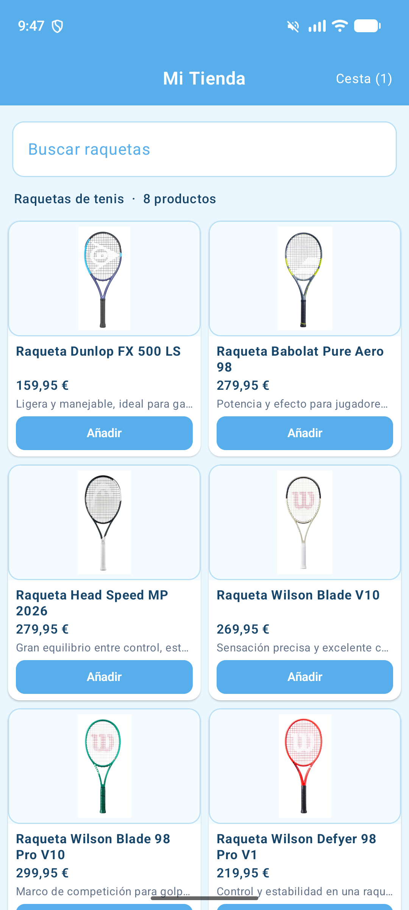
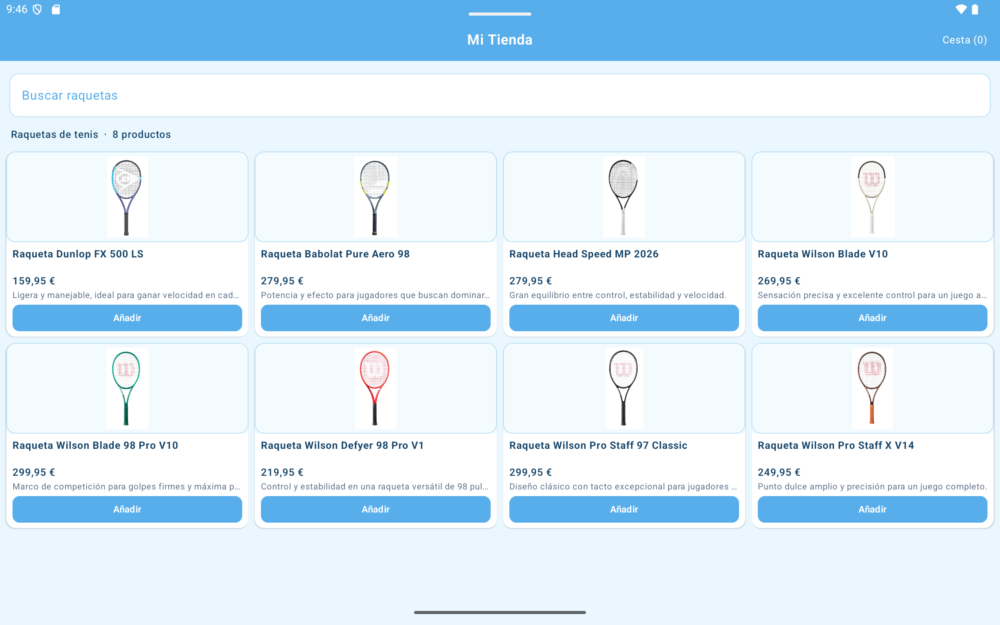

# Reto 2 · E-Commerce Adaptativo

Aplicación de catálogo de raquetas de tenis para Android, desarrollada con Kotlin y Jetpack Compose. El catálogo utiliza una cuadrícula perezosa adaptable: muestra dos columnas en un móvil habitual como el Pixel 7 y aumenta automáticamente el número de columnas en pantallas amplias, hasta cuatro en el perfil Pixel Tablet probado.

La interfaz usa una paleta celeste con fondo azul muy claro, tarjetas blancas y texto azul oscuro.

## Objetivo del reto

Sustituir una lista estática de productos por `LazyVerticalGrid`, de modo que la cantidad de columnas se adapte al espacio disponible y se mantengan las mismas tarjetas y los mismos datos en móvil y tablet.

En esta implementación, el requisito se concreta en **dos columnas en móviles** —según la preferencia indicada para este proyecto— y más columnas en tablets. No se fija un número único para todos los tamaños: `GridCells.Adaptive` decide cuántas caben según el ancho mínimo de celda.

## Funcionalidades

- Catálogo con ocho raquetas e imágenes locales incluidas en `app/src/main/res/drawable/`.
- Cuadrícula desplazable y adaptable con `LazyVerticalGrid`.
- Buscador que filtra los productos por nombre, sin distinguir mayúsculas y minúsculas.
- Tarjetas con imagen, nombre, descripción, precio de ejemplo y botón para añadir a la cesta.
- Contador de artículos en la cabecera.
- Interfaz en español y adaptación de dos a cuatro columnas según el ancho de pantalla.
- Diseño en tonos celestes para la cabecera, campos y botones.

> Los precios son valores ficticios orientativos para la demostración. No representan ofertas ni precios comprobados en tiendas.

## Diseño adaptable

El catálogo obtiene el ancho disponible con `BoxWithConstraints` y se lo da a `GridCells.Adaptive` como tamaño mínimo de celda:

```kotlin
val minCellSize = if (maxWidth >= 720.dp) {
    maxWidth / 4 - 16.dp
} else {
    160.dp
}

LazyVerticalGrid(
    columns = GridCells.Adaptive(minSize = minCellSize),
    // ...
)
```

- **Móvil (Pixel 7):** el tamaño mínimo de `160.dp` permite dos columnas en el ancho disponible del emulador.
- **Tablet (Pixel Tablet):** al alcanzar `720.dp` de ancho, el mínimo se calcula para que entren cuatro columnas con el espaciado de la cuadrícula.
- **Otros tamaños:** Compose vuelve a calcular el número de celdas cuando cambia el espacio disponible; no se mantienen listas duplicadas ni diseños separados para cada dispositivo.
- **Lista larga:** `LazyVerticalGrid` compone los elementos visibles según se necesitan y permite desplazarse por el catálogo.

El punto de corte de `720.dp` es una decisión de diseño para este ejercicio, no una regla universal de Android. En teléfonos especialmente estrechos puede caber una sola celda; en pantallas intermedias el número de columnas depende del ancho real.

## Capturas de los emuladores

Las capturas se guardan en `screenshots/` y se muestran a continuación.

### Móvil · Pixel 7

Dos columnas y el contador de cesta actualizado tras añadir un artículo.



### Tablet · Pixel Tablet

Cuatro columnas con las mismas tarjetas del catálogo.



## Tecnologías y configuración

- Kotlin
- Jetpack Compose y Material 3
- `LazyVerticalGrid`, `GridCells.Adaptive` y `BoxWithConstraints`
- Android `minSdk`: 24
- Java/Kotlin JVM target: 11
- `compileSdk`: 37

## Compilar y ejecutar

1. Abre en Android Studio la carpeta de este proyecto.
2. Espera a que Gradle sincronice y selecciona un emulador o dispositivo Android.
3. Ejecuta la configuración `app` desde Android Studio, o compila el APK de depuración desde PowerShell:

```powershell
.\gradlew.bat :app:assembleDebug
```

El APK se genera en:

```text
app/build/outputs/apk/debug/app-debug.apk
```

La compilación de verificación de este README terminó correctamente con JDK 21. Si Gradle selecciona un JDK/JRE distinto que no tenga `jlink`, configura `JAVA_HOME` a un JDK completo instalado antes de compilar.

## Estructura relevante

```text
app/
├── src/main/
│   ├── java/com/example/reto2e_commerceadaptativoresponsiveui/
│   │   └── MainActivity.kt   # Productos, cuadrícula y tarjetas Compose
│   └── res/drawable/         # Imágenes locales de las raquetas
└── build.gradle.kts          # Configuración Android y dependencias
screenshots/
├── phone-pixel7.png
└── tablet-pixel-tablet.png
```

## Reflexión crítica

### ¿Se ha implementado el reto técnico?

Sí. El catálogo se muestra con `LazyVerticalGrid` y `GridCells.Adaptive`; no hay una lista estática ni una cuadrícula distinta para cada dispositivo. El ancho se comprueba con `BoxWithConstraints` para ajustar el tamaño mínimo de celda en pantallas grandes. La comprobación visual en los emuladores mostró dos columnas en Pixel 7 y cuatro en Pixel Tablet.

### ¿Por qué usar una cuadrícula adaptable en vez de definir columnas fijas?

Una cuadrícula fija obligaría a escoger un único número de columnas o a mantener ramas específicas por dispositivo. `Adaptive` reutiliza los mismos productos y tarjetas, y calcula cuántas celdas caben cuando cambia el ancho, por ejemplo al rotar el dispositivo o al ejecutarse en una tablet.

### ¿Qué compromiso se tomó para el tamaño de las tarjetas?

El mínimo de `160.dp` permite aprovechar el espacio del móvil con dos columnas, pero reduce el ancho de cada tarjeta: algunos nombres y descripciones se recortan con puntos suspensivos. En una pantalla muy estrecha puede resultar más legible una columna; sería posible ajustar el mínimo y el diseño según una guía de tamaños probada con más dispositivos.

### ¿Qué se validó?

- La tarea `:app:assembleDebug` finaliza correctamente.
- La aplicación se instaló y abrió en los emuladores Pixel 7 y Pixel Tablet.
- La captura del móvil muestra dos columnas y la de tablet muestra cuatro.
- Se pulsó el botón «Añadir» en el móvil y se comprobó que el contador cambió a `Cesta (1)`.

### ¿Qué queda fuera de esta demostración?

Los productos y precios están escritos localmente en el código; no se consultan a un servidor ni se han contrastado con comercios. El contador de cesta es estado temporal de la pantalla: no conserva los artículos al reiniciar la aplicación, no registra cantidades por producto y no realiza compras. El buscador solo filtra nombres. Para una tienda real habría que incorporar persistencia, gestión completa de cesta, datos verificados, estados de carga/error y pruebas en dispositivos de distintos tamaños.
