# UDITflix · Pipeline de Transcodificación de Tráilers

**Reto 3 · Prueba A · PSP (0490) · 2º DAM** — Juan Giménez

Motor backend multihilo en Java que procesa un lote de tráilers de forma concurrente (un hilo por vídeo), vigila el ciclo de vida de cada hilo con `getState()` y compara el tiempo real secuencial con el concurrente.

> 🎥 **Vídeo de defensa técnica (< 3 min):** _[pega aquí el enlace]_

---

## Índice

1. [El problema](#1-el-problema)
2. [Requisitos y cómo se cumplen](#2-requisitos-y-cómo-se-cumplen)
3. [Arquitectura](#3-arquitectura)
4. [Explicación del código línea a línea](#4-explicación-del-código-línea-a-línea)
   - [4.1 `Video.java`](#41-videojava--los-datos-del-lote)
   - [4.2 `TareaTranscodificacion.java`](#42-tareatranscodificacionjava--el-trabajo-de-un-vídeo)
   - [4.3 `EspiaEstados.java`](#43-espiaestadosjava--el-monitor-de-estados)
   - [4.4 `MainUDITflix.java`](#44-mainuditflixjava--el-orquestador)
5. [Ciclo de vida de un hilo en este programa](#5-ciclo-de-vida-de-un-hilo-en-este-programa)
6. [Línea temporal de la ejecución](#6-línea-temporal-de-la-ejecución)
7. [Ejecución](#7-ejecución)
8. [Evidencias](#8-evidencias)
9. [Ampliación: el Espía como hilo demonio](#9-ampliación-el-espía-como-hilo-demonio)
10. [Errores típicos que evita esta solución](#10-errores-típicos-que-evita-esta-solución)
11. [Preguntas de metacognición](#11-preguntas-de-metacognición)

---

## 1. El problema

El servidor de catalogación transcodificaba los vídeos **uno detrás de otro**: un vídeo pesado (`episodio-1.mp4`, 4 s) retenía a todos los que iban detrás y el servidor quedaba bloqueado con lotes grandes.

El cliente pide:
- Procesar el lote **de forma concurrente** (un hilo independiente por vídeo).
- Poder ver **en qué estado está cada tarea** en todo momento.
- Saber **cuánto tiempo se ahorra** respecto al modelo secuencial.

## 2. Requisitos y cómo se cumplen

| Requisito | Qué pide | Dónde se cumple |
|---|---|---|
| **RT1** · Lote de vídeos | 4 vídeos con duraciones fijas en una estructura de datos; un hilo con nombre propio por vídeo | [`MainUDITflix.java:10-15`](src/MainUDITflix.java#L10-L15) (array `LOTE`) y [`:45`](src/MainUDITflix.java#L45) (`new Thread(..., "WORKER-n")`) |
| **RT2** · `start()` y `join()` | Lanzar con `start()`, esperar con `join()` | [`MainUDITflix.java:57-61`](src/MainUDITflix.java#L57-L61) y [`:69-71`](src/MainUDITflix.java#L69-L71) |
| **RT3** · Medir el ahorro | Tiempo secuencial real, concurrente real y ahorro en ms y % | [`MainUDITflix.java:29-36`](src/MainUDITflix.java#L29-L36), [`:56`](src/MainUDITflix.java#L56), [`:72`](src/MainUDITflix.java#L72) y [`:80-96`](src/MainUDITflix.java#L80-L96) |
| **RT4** · Espía de Estados | Monitor periódico con `getState()` que para cuando todos acaban; se ven `NEW`, `TIMED_WAITING`, `TERMINATED` | [`EspiaEstados.java`](src/EspiaEstados.java) completo |
| **Ampliación** · Daemon | Espía con `setDaemon(true)` y explicación | [`MainUDITflix.java:64`](src/MainUDITflix.java#L64) y [sección 9](#9-ampliación-el-espía-como-hilo-demonio) |

## 3. Arquitectura

```
src/
├── Video.java                   record (nombre, duracionMs): un elemento del lote
├── TareaTranscodificacion.java  Runnable: el trabajo de UN vídeo (Thread.sleep simulado)
├── EspiaEstados.java            Runnable: cada 500 ms imprime getState() de los 4 workers
└── MainUDITflix.java            Orquestador: lote, modo secuencial, modo concurrente y resumen
```

### Relación entre clases

```
                 ┌──────────────────────┐
                 │     MainUDITflix     │
                 │  (hilo "main")       │
                 └──────────┬───────────┘
          usa el lote       │        crea y lanza
     ┌──────────────────────┼─────────────────────────────┐
     ▼                      ▼                             ▼
┌─────────┐   ┌────────────────────────────┐   ┌──────────────────────┐
│  Video  │◄──│  TareaTranscodificacion    │   │     EspiaEstados     │
│ (record)│   │  implements Runnable       │   │  implements Runnable │
└─────────┘   │  ×4 → WORKER-1 … WORKER-4  │◄──│  lee getState() de   │
              └────────────────────────────┘   │  los 4 workers       │
                                               │  → hilo "ESPIA"      │
                                               │    (daemon)          │
                                               └──────────────────────┘
```

### Diagrama de clases (UML)

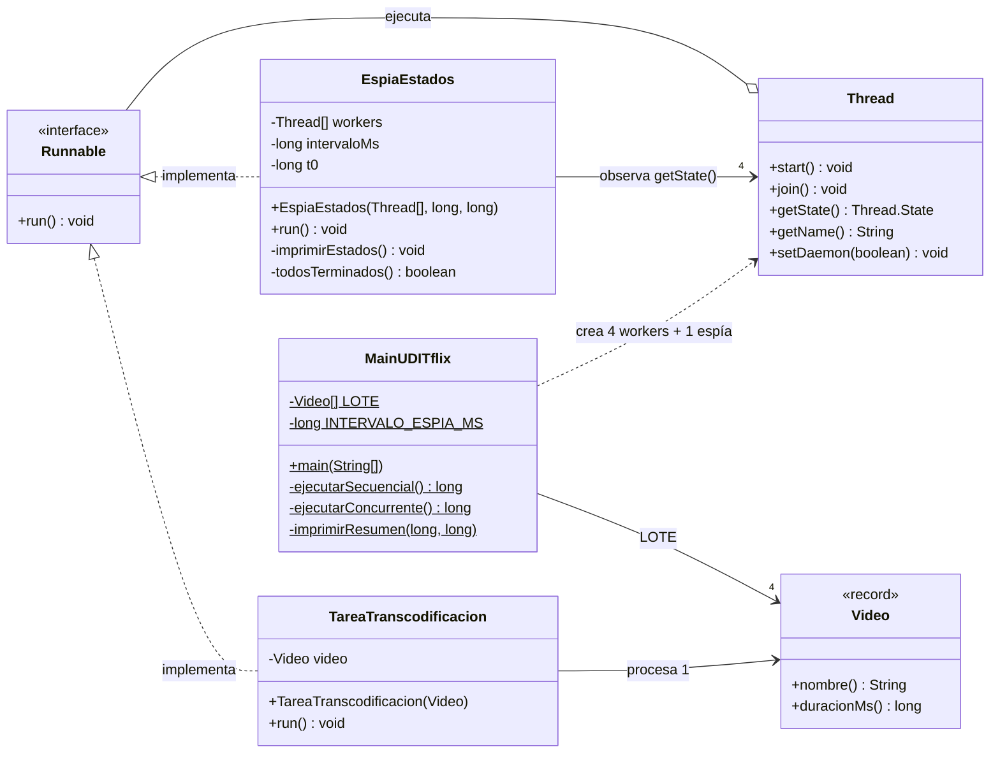

### Hilos que existen durante la ejecución

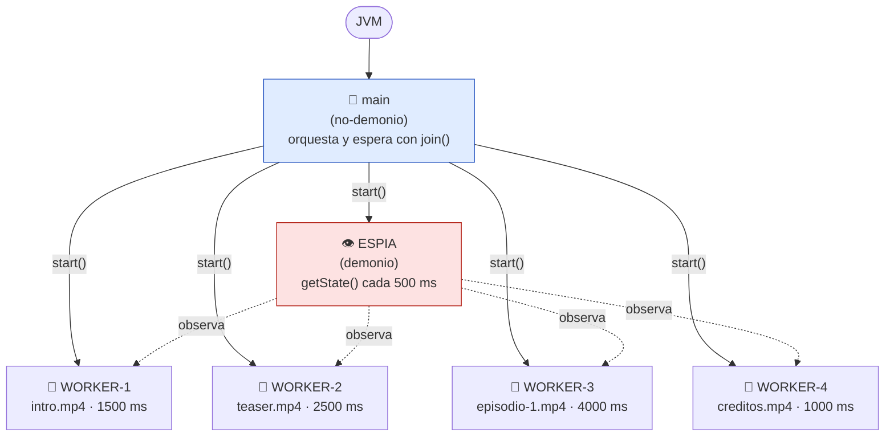

En total hay **6 hilos** en el modo concurrente: `main`, los 4 workers y el espía. En el modo secuencial solo existe **uno**: `main`.

| Clase | Responsabilidad | Decisión técnica |
|---|---|---|
| `Video` | Datos del lote | `record` inmutable; el lote es un array `Video[] LOTE`, sin datos repetidos a mano (RT1). |
| `TareaTranscodificacion` | Qué hace cada worker | Implementa `Runnable` (no extiende `Thread`): separa la *tarea* del *hilo* y permite reutilizarla igual en modo secuencial (`run()`) y concurrente (`start()`). |
| `EspiaEstados` | Monitor del ciclo de vida | Hilo propio, **demonio**, que se detiene solo cuando los 4 workers están en `TERMINATED` (RT4). |
| `MainUDITflix` | Flujo completo | 1) secuencial real, 2) concurrente con `start()` + `join()`, 3) resumen con ahorro (RT2, RT3). |

### Flujo general del programa

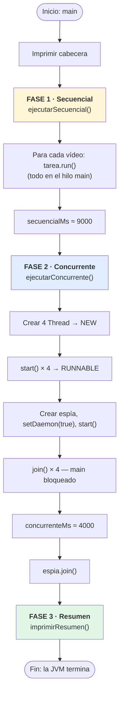

### ¿Por qué el espía es un hilo propio y no un bucle en `main`?

El enunciado permite las dos opciones. Elegí un hilo aparte porque así `main` queda dedicado a una sola cosa —**esperar con `join()`**—, que es justo lo que se evalúa en el criterio de *Sincronización*. Si `main` hiciera de espía, tendría que mezclar el bucle de muestreo con la espera y el `join()` quedaría en segundo plano. Además, me permite aplicar la ampliación del hilo demonio.

---

## 4. Explicación del código línea a línea

### 4.1 `Video.java` — los datos del lote

```java
1  /**
2   * Un tráiler del lote: nombre del fichero y duración simulada de su transcodificación.
3   * Es un record porque solo transporta datos inmutables.
4   */
5  public record Video(String nombre, long duracionMs) {
6  }
```

| Línea | Qué hace | Por qué |
|---|---|---|
| 1-4 | Comentario Javadoc que describe la clase. | Documenta la intención para quien lea el código. |
| 5 | Declara un **`record`** con dos componentes: `nombre` (`String`) y `duracionMs` (`long`). | Un `record` (Java 16+) genera automáticamente el constructor, los métodos de acceso `nombre()` y `duracionMs()`, y `equals`, `hashCode` y `toString`. Sus campos son `final`, así que un vídeo no puede cambiar de duración a mitad de ejecución. Uso `long` porque `Thread.sleep()` y `System.currentTimeMillis()` trabajan en `long`. |
| 6 | Cierra el record. No necesita cuerpo. | No hay lógica: solo transporta datos. |

**Qué genera Java automáticamente con esa única línea:**

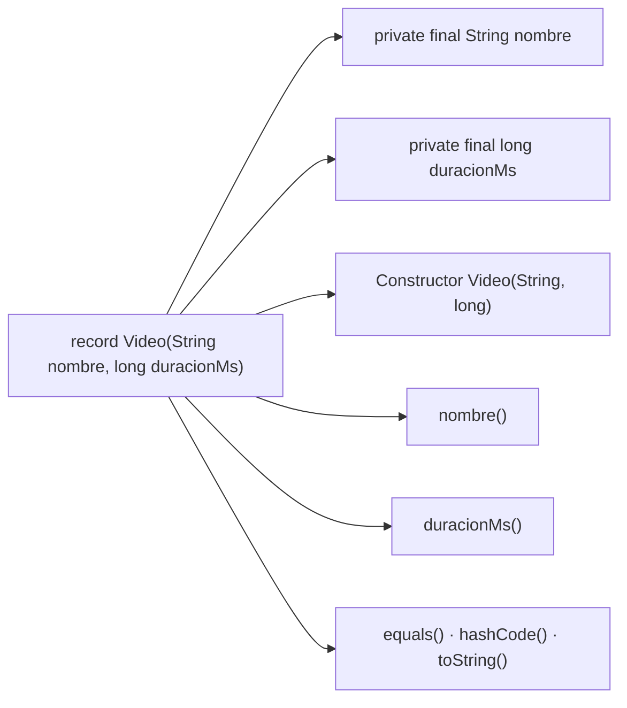

**El lote en memoria (array `LOTE`):**

| Índice | `nombre()` | `duracionMs()` | Hilo que lo procesará |
|---|---|---|---|
| `LOTE[0]` | `intro.mp4` | 1500 | `WORKER-1` |
| `LOTE[1]` | `teaser.mp4` | 2500 | `WORKER-2` |
| `LOTE[2]` | `episodio-1.mp4` | 4000 | `WORKER-3` |
| `LOTE[3]` | `creditos.mp4` | 1000 | `WORKER-4` |

---

### 4.2 `TareaTranscodificacion.java` — el trabajo de un vídeo

```java
 7  public class TareaTranscodificacion implements Runnable {
 8
 9      private final Video video;
10
11      public TareaTranscodificacion(Video video) {
12          this.video = video;
13      }
14
15      @Override
16      public void run() {
17          String hilo = Thread.currentThread().getName();
18          System.out.printf("[%s] INICIO      %-15s (%d ms)%n", hilo, video.nombre(), video.duracionMs());
19          try {
20              // Simula el trabajo pesado. Mientras duerme, el hilo está en TIMED_WAITING.
21              Thread.sleep(video.duracionMs());
22          } catch (InterruptedException e) {
23              Thread.currentThread().interrupt();
24              System.out.printf("[%s] INTERRUMPIDO %s%n", hilo, video.nombre());
25              return;
26          }
27          System.out.printf("[%s] COMPLETADO  %-15s%n", hilo, video.nombre());
28      }
29  }
```

| Línea | Qué hace | Por qué |
|---|---|---|
| 1-6 | Javadoc: explica que la clase describe *qué* se hace, no *cómo* se ejecuta. | Es la idea central de `Runnable`. |
| 7 | La clase **implementa `Runnable`**. | `Runnable` es una interfaz con un único método, `run()`. Representa "un trabajo que se puede ejecutar". No es un hilo: para que sea concurrente hay que dárselo a un `Thread`. |
| 9 | Atributo `private final Video video`. | Cada tarea sabe qué vídeo le toca. `final` porque no cambia una vez creada la tarea; además, los campos `final` se publican de forma segura a otros hilos. |
| 11-13 | Constructor que recibe el vídeo y lo guarda. | Así los datos vienen del array `LOTE` y no están escritos a mano dentro de la tarea. |
| 15 | `@Override` | Indica al compilador que estamos implementando `run()` de `Runnable`; si nos equivocamos en la firma, da error. |
| 16 | `public void run()` | Es el código que ejecutará el hilo. Cuando `run()` termina, el hilo pasa a **`TERMINATED`**. |
| 17 | `Thread.currentThread().getName()` | Obtiene el nombre del hilo **que está ejecutando este código en este momento**. En modo secuencial devuelve `main`; en concurrente, `WORKER-1`, `WORKER-2`… Es la prueba visible de que `run()` no crea hilos y `start()` sí. |
| 18 | `printf` con `INICIO`. | `%s` → nombre del hilo; `%-15s` → nombre del vídeo alineado a la izquierda en 15 caracteres (para que las columnas cuadren); `%d` → duración; `%n` → salto de línea del sistema. |
| 19 | Abre `try`. | `Thread.sleep()` lanza `InterruptedException` (excepción comprobada), así que hay que capturarla o declararla. `run()` no puede declarar `throws` porque la firma de `Runnable.run()` no lo permite. |
| 21 | `Thread.sleep(video.duracionMs())` | **Simula la transcodificación.** El hilo se duerme el tiempo indicado sin consumir CPU. Mientras duerme, su estado es **`TIMED_WAITING`** (espera con tiempo límite). |
| 22 | `catch (InterruptedException e)` | Se activaría si otro hilo llamara a `interrupt()` sobre este worker mientras duerme. |
| 23 | `Thread.currentThread().interrupt()` | Buena práctica: al capturar la excepción Java **borra** la marca de interrupción; la volvemos a poner para que quien esté por encima sepa que el hilo fue interrumpido. |
| 24-25 | Mensaje `INTERRUMPIDO` y `return`. | Si se interrumpe, no tiene sentido imprimir `COMPLETADO`. |
| 27 | `printf` con `COMPLETADO`. | Marca el final del trabajo. Justo después termina `run()` y el hilo pasa a `TERMINATED`. |

**Diagrama de flujo de `run()` con el estado del hilo en cada punto:**

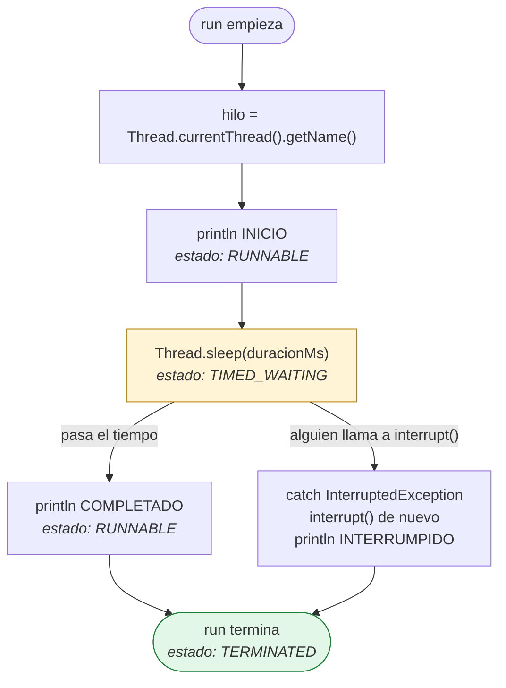

**La misma tarea, dos formas de ejecutarla:**

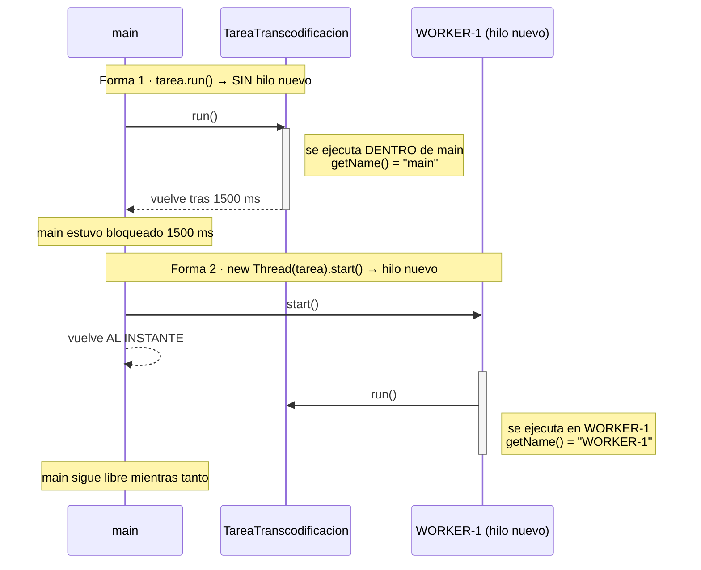

---

### 4.3 `EspiaEstados.java` — el monitor de estados

```java
 5  public class EspiaEstados implements Runnable {
 6
 7      private final Thread[] workers;
 8      private final long intervaloMs;
 9      private final long t0;
10
11      public EspiaEstados(Thread[] workers, long intervaloMs, long t0) {
12          this.workers = workers;
13          this.intervaloMs = intervaloMs;
14          this.t0 = t0;
15      }
16
17      @Override
18      public void run() {
19          try {
20              while (true) {
21                  imprimirEstados();
22                  if (todosTerminados()) {
23                      break;
24                  }
25                  Thread.sleep(intervaloMs);
26              }
27          } catch (InterruptedException e) {
28              Thread.currentThread().interrupt();
29          }
30      }
31
32      private void imprimirEstados() {
33          long transcurrido = System.currentTimeMillis() - t0;
34          StringBuilder linea = new StringBuilder(String.format("[ESPIA +%5d ms]", transcurrido));
35          for (int i = 0; i < workers.length; i++) {
36              linea.append(String.format(" W%d=%-14s", i + 1, workers[i].getState()));
37          }
38          System.out.println(linea);
39      }
40
41      private boolean todosTerminados() {
42          for (Thread w : workers) {
43              if (w.getState() != Thread.State.TERMINATED) {
44                  return false;
45              }
46          }
47          return true;
48      }
49  }
```

| Línea | Qué hace | Por qué |
|---|---|---|
| 5 | El espía también **implementa `Runnable`**. | Así se ejecuta en su propio hilo (`ESPIA`) en paralelo a los workers, igual que ellos. |
| 7 | `Thread[] workers` | Referencias a los 4 hilos que vigila. Necesita el objeto `Thread` (no el `Runnable`) porque `getState()` es un método de `Thread`. |
| 8 | `intervaloMs` | Cada cuánto muestrea (500 ms). Se pasa por constructor para no dejar el número escrito a fuego. |
| 9 | `t0` | Instante en que se lanzaron los workers. Sirve para imprimir el tiempo relativo `+500 ms`, `+1000 ms`… |
| 11-15 | Constructor. | Guarda los tres datos. |
| 18 | `run()` del espía. | Es lo que hace el hilo `ESPIA`. |
| 20 | `while (true)` | Bucle de muestreo. La salida está controlada dentro (línea 23). |
| 21 | `imprimirEstados()` | **Primero imprime** y luego comprueba. Así la última línea que se ve es la de los 4 en `TERMINATED`, que es la evidencia que pide RT4. |
| 22-24 | Si todos han terminado, `break`. | **Condición de parada** del requisito: «debe dejar de espiar cuando todos hayan terminado». Sin ella, el espía seguiría para siempre. |
| 25 | `Thread.sleep(intervaloMs)` | Espera 500 ms hasta la siguiente muestra. Mientras duerme, el propio espía está en `TIMED_WAITING`. |
| 27-29 | Captura `InterruptedException`. | Misma buena práctica que en la tarea: restaura la marca de interrupción. |
| 33 | `System.currentTimeMillis() - t0` | Milisegundos desde que se lanzaron los workers. |
| 34 | `StringBuilder` con la cabecera `[ESPIA + xxx ms]`. | `%5d` reserva 5 caracteres para que las columnas queden alineadas. `StringBuilder` evita crear muchos `String` intermedios al concatenar en un bucle. |
| 35-37 | Recorre los workers y añade ` Wn=ESTADO`. | **`workers[i].getState()`** devuelve un valor del enum `Thread.State` (`NEW`, `RUNNABLE`, `BLOCKED`, `WAITING`, `TIMED_WAITING`, `TERMINATED`). `%-14s` alinea el texto en 14 caracteres (la longitud de `TIMED_WAITING` + 1). |
| 38 | Imprime la línea completa de una vez. | Imprimir en una sola llamada evita que las trazas de otros hilos se cuelen en medio de la línea. |
| 41-48 | `todosTerminados()` | Devuelve `false` en cuanto encuentra un worker que no está en `TERMINATED`; si los recorre todos sin encontrarlo, devuelve `true`. Se compara con `!=` porque los valores de un `enum` son únicos (se puede comparar por referencia). |

**Diagrama de flujo del bucle del espía:**

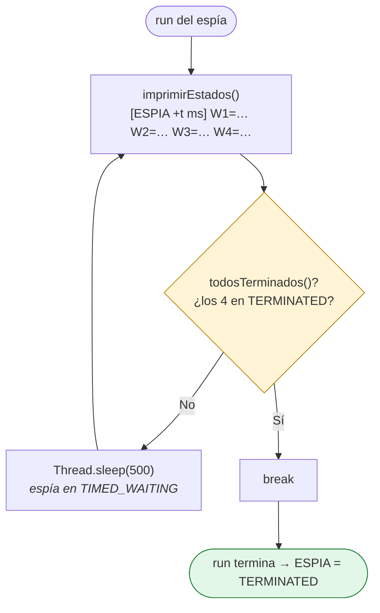

**Cómo funciona `todosTerminados()`:**

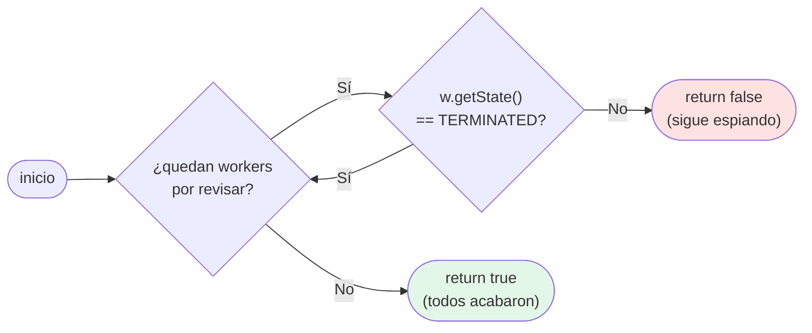

**Lo que "ve" el espía en cada muestra:**

| Muestra | W1 · intro (1,5 s) | W2 · teaser (2,5 s) | W3 · episodio-1 (4 s) | W4 · creditos (1 s) | ¿Para? |
|---|---|---|---|---|---|
| +0 ms | 🟡 TIMED_WAITING | 🟡 TIMED_WAITING | 🟡 TIMED_WAITING | 🟡 TIMED_WAITING | No |
| +500 ms | 🟡 TIMED_WAITING | 🟡 TIMED_WAITING | 🟡 TIMED_WAITING | 🟡 TIMED_WAITING | No |
| +1000 ms | 🟡 TIMED_WAITING | 🟡 TIMED_WAITING | 🟡 TIMED_WAITING | 🟢 TERMINATED | No |
| +1500 ms | 🟢 TERMINATED | 🟡 TIMED_WAITING | 🟡 TIMED_WAITING | 🟢 TERMINATED | No |
| +2000 ms | 🟢 TERMINATED | 🟡 TIMED_WAITING | 🟡 TIMED_WAITING | 🟢 TERMINATED | No |
| +2500 ms | 🟢 TERMINATED | 🟢 TERMINATED | 🟡 TIMED_WAITING | 🟢 TERMINATED | No |
| +3000 ms | 🟢 TERMINATED | 🟢 TERMINATED | 🟡 TIMED_WAITING | 🟢 TERMINATED | No |
| +3500 ms | 🟢 TERMINATED | 🟢 TERMINATED | 🟡 TIMED_WAITING | 🟢 TERMINATED | No |
| +4000 ms | 🟢 TERMINATED | 🟢 TERMINATED | 🟢 TERMINATED | 🟢 TERMINATED | **Sí → break** |

> En las muestras que caen justo en el límite (+1000, +1500, +2500, +4000 ms) el espía duerme un poco más de 500 ms reales, así que llega cuando el worker ya ha terminado. Por eso en la traza real se ven tiempos como `+1029 ms` o `+4103 ms`.

> **Nota:** `getState()` es una *foto* del estado en ese instante, pensada para monitorización, no para sincronizar. Por eso el espía solo observa; la sincronización real la hace `join()` en `main`.

---

### 4.4 `MainUDITflix.java` — el orquestador

#### a) Datos y método `main` (líneas 7-26)

```java
 7  public class MainUDITflix {
 9      // RT1: el lote vive en una estructura de datos, no repetido a mano en el código.
10      private static final Video[] LOTE = {
11              new Video("intro.mp4", 1500),
12              new Video("teaser.mp4", 2500),
13              new Video("episodio-1.mp4", 4000),
14              new Video("creditos.mp4", 1000)
15      };
17      private static final long INTERVALO_ESPIA_MS = 500;
19      public static void main(String[] args) throws InterruptedException {
20          System.out.println("===== UDITflix - Pipeline de Transcodificacion =====");
22          long secuencialMs = ejecutarSecuencial();
23          long concurrenteMs = ejecutarConcurrente();
25          imprimirResumen(secuencialMs, concurrenteMs);
26      }
```

| Línea | Qué hace | Por qué |
|---|---|---|
| 10-15 | Array constante `LOTE` con los 4 vídeos y sus duraciones fijas. | **RT1**: los datos están en una estructura. Todo el programa recorre este array; si mañana hay 10 vídeos, solo se cambia aquí. Duraciones fijas → resultados reproducibles. |
| 17 | `INTERVALO_ESPIA_MS = 500` | Constante con nombre en lugar de un "número mágico". |
| 19 | `main(...) throws InterruptedException` | `join()` puede lanzar `InterruptedException`; en `main` la propagamos porque nadie va a interrumpir el hilo principal. |
| 22 | Ejecuta el modo secuencial y guarda su duración. | Primera medición real de RT3. |
| 23 | Ejecuta el modo concurrente y guarda su duración. | Segunda medición real, **en la misma ejecución**, como pide RT3. |
| 25 | Imprime el resumen comparativo. | Solo se llega aquí cuando `ejecutarConcurrente()` ha vuelto, es decir, después de todos los `join()`. |

#### b) Modo secuencial (líneas 29-36)

```java
29      private static long ejecutarSecuencial() {
30          System.out.println("\n--- MODO SECUENCIAL (run() en el hilo main) ---");
31          long inicio = System.currentTimeMillis();
32          for (Video v : LOTE) {
33              new TareaTranscodificacion(v).run();
34          }
35          return System.currentTimeMillis() - inicio;
36      }
```

| Línea | Qué hace | Por qué |
|---|---|---|
| 31 | Guarda el instante inicial. | Cronómetro del modo secuencial. |
| 32 | Recorre el lote. | Usa la estructura de datos de RT1. |
| 33 | `new TareaTranscodificacion(v).run()` | **Llamada directa a `run()`**: es una llamada a método normal, **no crea ningún hilo**. Se ejecuta dentro de `main` y bloquea hasta que termina el `sleep`. La siguiente tarea no empieza hasta que acaba la anterior → **secuencial real**. Por eso la traza muestra `[main]`. |
| 35 | Devuelve el tiempo transcurrido. | ≈ 1500 + 2500 + 4000 + 1000 = **9000 ms**, más unos pocos ms de sobrecoste. |

**Diagrama de secuencia del modo secuencial:**

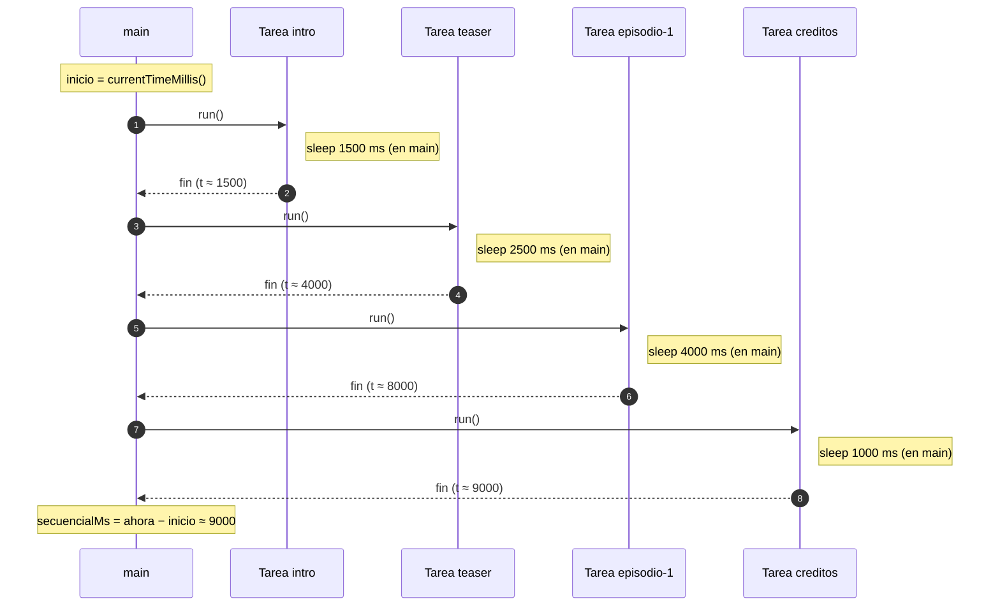

Cada flecha `run()` **bloquea a `main`** hasta que vuelve: no hay ningún solapamiento.

> Aquí usar `run()` es **intencionado**: el enunciado prohíbe `run()` solo para la parte concurrente. Para medir el modelo antiguo es exactamente lo que necesitamos.

#### c) Modo concurrente (líneas 39-78) — el corazón del reto

**Paso 1 · Nacen los hilos (estado `NEW`)**

```java
43          Thread[] workers = new Thread[LOTE.length];
44          for (int i = 0; i < LOTE.length; i++) {
45              workers[i] = new Thread(new TareaTranscodificacion(LOTE[i]), "WORKER-" + (i + 1));
46          }
48          StringBuilder inicial = new StringBuilder("[MAIN] Estado inicial:");
49          for (Thread w : workers) {
50              inicial.append(' ').append(w.getName()).append('=').append(w.getState());
51          }
52          System.out.println(inicial);
```

| Línea | Qué hace | Por qué |
|---|---|---|
| 43 | Crea un array de `Thread` del mismo tamaño que el lote. | Necesitamos guardar las referencias para lanzarlos, esperarlos y espiarlos después. |
| 45 | `new Thread(runnable, nombre)` | Constructor de `Thread` que recibe **el trabajo** (`Runnable`) y **un nombre propio** (`WORKER-1`…`WORKER-4`). El hilo existe como objeto pero **todavía no se ejecuta**: está en **`NEW`**. |
| 48-52 | Imprime `getState()` de cada worker antes de lanzarlo. | Evidencia del estado **`NEW`** que pide RT4. |

**Paso 2 · Arrancan los hilos (estado `RUNNABLE`)**

```java
55          System.out.println("[MAIN] Lanzando workers...");
56          long inicio = System.currentTimeMillis();
57          for (Thread w : workers) {
58              w.start();
59              // Justo tras start() el hilo suele estar RUNNABLE (listo o arrancando).
60              System.out.println("[MAIN] " + w.getName() + " tras start() = " + w.getState());
61          }
```

| Línea | Qué hace | Por qué |
|---|---|---|
| 56 | Arranca el cronómetro del modo concurrente **justo antes** del primer `start()`. | Así medimos solo el trabajo, no la creación de objetos. |
| 58 | **`w.start()`** | Pide a la JVM que **cree un hilo nuevo del sistema** y que ese hilo ejecute `run()`. `start()` **vuelve inmediatamente**: `main` no espera y sigue con el siguiente worker. Por eso los 4 arrancan casi a la vez. (Llamar a `start()` dos veces sobre el mismo hilo lanzaría `IllegalThreadStateException`.) |
| 60 | Imprime el estado justo después del `start()`. | Captura el estado **`RUNNABLE`**: el hilo está listo o empezando a ejecutarse, aún no ha llegado al `sleep`. El espía casi nunca lo ve porque dura microsegundos. |

**Paso 3 · Se lanza el espía (daemon)**

```java
63          Thread espia = new Thread(new EspiaEstados(workers, INTERVALO_ESPIA_MS, inicio), "ESPIA");
64          espia.setDaemon(true); // Ampliación: no impide que la JVM termine.
65          espia.start();
```

| Línea | Qué hace | Por qué |
|---|---|---|
| 63 | Crea el hilo `ESPIA` con el `Runnable` del espía, pasándole los workers, el intervalo y el instante `inicio`. | Comparte el mismo `t0` que el cronómetro, así los tiempos del espía cuadran con la medición. |
| 64 | `setDaemon(true)` | Marca el hilo como **demonio**. Debe hacerse **antes** de `start()` (después lanzaría `IllegalThreadStateException`). Ver [sección 9](#9-ampliación-el-espía-como-hilo-demonio). |
| 65 | `espia.start()` | Arranca el espía en paralelo a los workers. |

**Paso 4 · `main` espera a todos (`join()`)**

```java
69          for (Thread w : workers) {
70              w.join();
71          }
72          long duracion = System.currentTimeMillis() - inicio;
76          espia.join();
77          return duracion;
```

| Línea | Qué hace | Por qué |
|---|---|---|
| 69-71 | **`w.join()`** sobre cada worker, en un **bucle separado** del de `start()`. | `join()` **bloquea al hilo que lo llama (`main`)** hasta que el hilo `w` termina. Mientras espera, `main` está en estado `WAITING`. Como todos ya están lanzados, los `join()` se van resolviendo: el primero espera a `WORKER-1` hasta los 1,5 s; el segundo, a `WORKER-2` hasta los 2,5 s; cuando le toca a `WORKER-3` solo le quedan 1,5 s más (hasta los 4 s); y `WORKER-4` ya terminó al segundo 1, así que su `join()` vuelve al instante. En total, `main` espera **lo que tarda el más lento**. |
| 72 | Para el cronómetro **después del último `join()`**. | Garantiza que medimos hasta que termina **el último** worker. ≈ **4000 ms**. |
| 76 | `espia.join()` | Espera a que el espía imprima su última línea (todo `TERMINATED`). Sin esto, el resumen podría salir mezclado con la traza del espía. |
| 77 | Devuelve la duración concurrente. | Se usa en el resumen. |

> **Clave del reto:** si se escribiera `w.start(); w.join();` **en el mismo bucle**, `main` esperaría a que acabe cada hilo antes de lanzar el siguiente → volveríamos a tener **9000 ms**, aunque haya hilos.

**Diagrama de secuencia completo del modo concurrente:**

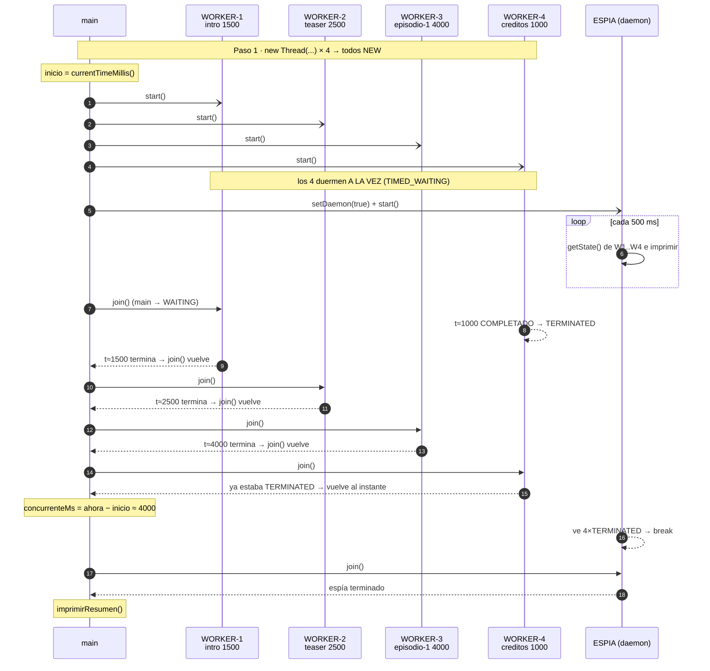

Las flechas `-)` (asíncronas) de `start()` indican que `main` **no espera**: lanza el hilo y sigue. Las flechas `->>` de `join()` sí bloquean a `main`.

**Qué hace `main` mientras espera en los `join()`:**

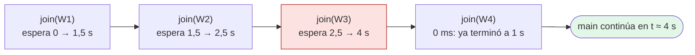

La suma de las esperas es 1,5 + 1 + 1,5 + 0 = **4 s**: exactamente la duración del más lento. El orden de los `join()` **no cambia** el tiempo total, porque los hilos ya estaban corriendo todos a la vez.

**Comparación: correcto vs. error típico**

```mermaid
flowchart TB
    subgraph OK["✅ Correcto: dos bucles"]
        direction LR
        a1["start W1"] --> a2["start W2"] --> a3["start W3"] --> a4["start W4"]
        a4 --> b1["join W1"] --> b2["join W2"] --> b3["join W3"] --> b4["join W4"]
        b4 --> r1(["≈ 4000 ms"])
    end
    subgraph KO["❌ Error: start + join en el mismo bucle"]
        direction LR
        c1["start W1"] --> d1["join W1<br/>1,5 s"] --> c2["start W2"] --> d2["join W2<br/>2,5 s"] --> c3["start W3"] --> d3["join W3<br/>4 s"] --> c4["start W4"] --> d4["join W4<br/>1 s"]
        d4 --> r2(["≈ 9000 ms"])
    end
    style OK fill:#e3f7e8,stroke:#1a7f37
    style KO fill:#fde2e2,stroke:#b42318
```

#### d) Resumen (líneas 80-96)

```java
80      private static void imprimirResumen(long secuencialMs, long concurrenteMs) {
81          long masLento = 0;
82          long suma = 0;
83          for (Video v : LOTE) {
84              masLento = Math.max(masLento, v.duracionMs());
85              suma += v.duracionMs();
86          }
87          long ahorro = secuencialMs - concurrenteMs;
88          double porcentaje = secuencialMs == 0 ? 0 : ahorro * 100.0 / secuencialMs;
90          System.out.println("\n===== RESUMEN =====");
91          ...printf de los 5 valores...
96      }
```

| Línea | Qué hace | Por qué |
|---|---|---|
| 81-86 | Calcula la **suma** y el **máximo** de las duraciones del lote. | Son los valores *teóricos* que ya calculaba la base v0. Sirven para comparar con los tiempos *reales*. |
| 84 | `Math.max(...)` | Se queda con la duración mayor (el cuello de botella). |
| 87 | `ahorro = secuencial − concurrente` | Ahorro en milisegundos. |
| 88 | `ahorro * 100.0 / secuencial` | Ahorro en porcentaje. El `100.0` (double) fuerza división decimal; con `100` se haría división entera y se perderían los decimales. El ternario evita dividir entre 0. |
| 91-95 | `printf` con `%5d` y `%.1f %%`. | `%5d` alinea los números en 5 cifras; `%.1f` muestra un decimal; `%%` imprime el símbolo `%` literal. |

**Flujo de cálculo del resumen:**

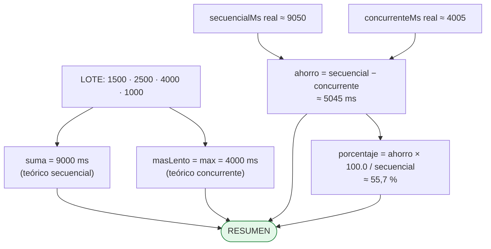

**Reparto del tiempo secuencial (9050 ms):**

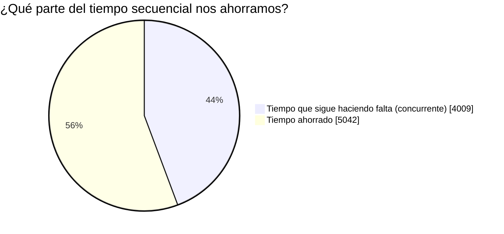

**Comparación de tiempos (ms):**

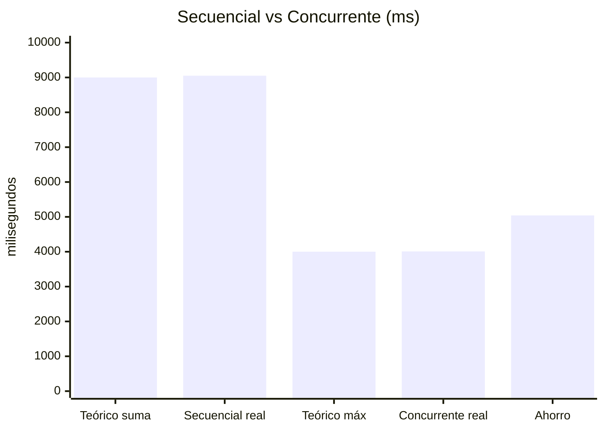

---

## 5. Ciclo de vida de un hilo en este programa

```
          new Thread(...)                 start()
  (nada) ───────────────►   NEW   ─────────────────►  RUNNABLE
                         [línea 45]      [línea 58]   (imprime INICIO)
                                                          │
                                                          │ Thread.sleep(ms)
                                                          ▼
                                                    TIMED_WAITING
                                                  (simula el trabajo)
                                                          │
                                                          │ se acaba el sleep
                                                          ▼
                                                      RUNNABLE
                                                  (imprime COMPLETADO)
                                                          │
                                                          │ fin de run()
                                                          ▼
                                                     TERMINATED
```

**Diagrama de estados (UML):**

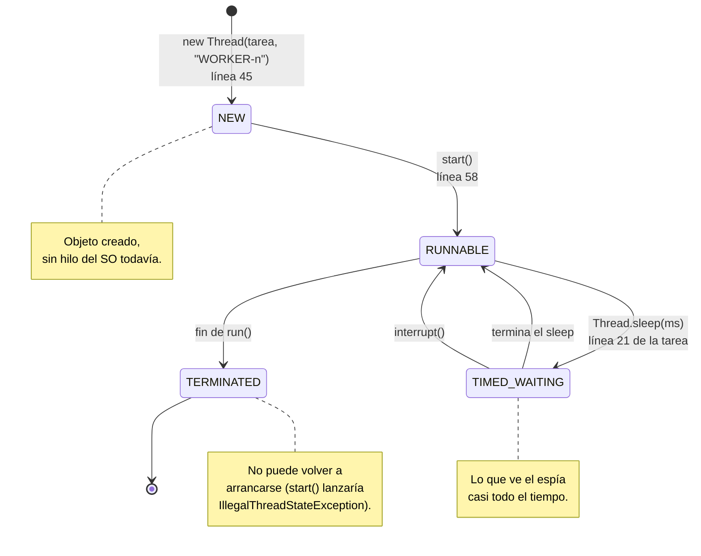

**Y el hilo `main`, ¿por qué estados pasa?**

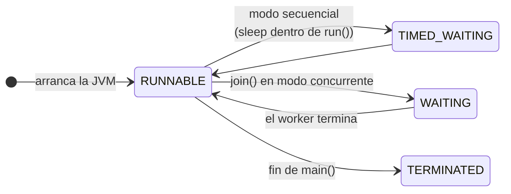

| Estado | Cuándo se ve en este programa | Dónde aparece en la traza |
|---|---|---|
| `NEW` | Tras `new Thread(...)` y antes de `start()`. | `[MAIN] Estado inicial: WORKER-1=NEW ...` |
| `RUNNABLE` | Justo después de `start()`, antes de entrar en `sleep`. | `[MAIN] WORKER-1 tras start() = RUNNABLE` |
| `TIMED_WAITING` | Dentro de `Thread.sleep(...)`. | Casi todas las líneas `[ESPIA ...]` |
| `TERMINATED` | Cuando `run()` ha terminado. | `[ESPIA ...] W4=TERMINATED` a partir de ~1000 ms |
| `WAITING` | Lo tiene `main` mientras está bloqueado en `join()` (no se imprime). | — |

## 6. Línea temporal de la ejecución

```
 Modo SECUENCIAL (todo en "main"):
 0 ms        1500       4000                 8000     9000
 |──intro────|──teaser───|─────episodio-1─────|─creditos─|      ≈ 9000 ms

 Modo CONCURRENTE (un hilo por vídeo):
 0 ms     1000  1500   2500             4000
 W1 |──intro────|                         |
 W2 |──teaser──────────|                  |
 W3 |─────────episodio-1──────────────────|
 W4 |─creditos─|                          |
 main ··········· join() ················►|  resumen             ≈ 4000 ms
 ESPIA ▲    ▲    ▲    ▲    ▲    ▲    ▲    ▲   (cada 500 ms)
```

### Diagrama de Gantt · modo secuencial

```mermaid
gantt
    title Modo SECUENCIAL — todo en el hilo main (≈ 9000 ms)
    dateFormat x
    axisFormat %S.%L s
    section main
    intro.mp4 (1500)       :a1, 0, 1500
    teaser.mp4 (2500)      :a2, 1500, 4000
    episodio-1.mp4 (4000)  :crit, a3, 4000, 8000
    creditos.mp4 (1000)    :a4, 8000, 9000
```

### Diagrama de Gantt · modo concurrente

```mermaid
gantt
    title Modo CONCURRENTE — un hilo por vídeo (≈ 4000 ms)
    dateFormat x
    axisFormat %S.%L s
    section WORKER-1
    intro.mp4 (1500)       :w1, 0, 1500
    section WORKER-2
    teaser.mp4 (2500)      :w2, 0, 2500
    section WORKER-3
    episodio-1.mp4 (4000)  :crit, w3, 0, 4000
    section WORKER-4
    creditos.mp4 (1000)    :w4, 0, 1000
    section main
    join() esperando       :active, m1, 0, 4000
    section ESPIA
    muestras cada 500 ms   :e1, 0, 4000
```

La barra roja (`crit`) es el **camino crítico**: el vídeo más largo marca el tiempo total en ambos modos, pero en el concurrente es lo **único** que hay que esperar.

El tiempo concurrente lo marca el vídeo más largo (`episodio-1.mp4`, 4000 ms). Ahorro ≈ 9000 − 4000 = **5000 ms (≈ 55 %)**.

---

## 7. Ejecución

**IntelliJ IDEA:**
1. *File → Open…* y seleccionar la carpeta `Reto3_A_Pipeline_Transcodificacion`.
2. Configurar un JDK 17 o superior (*File → Project Structure → Project → SDK*). Hace falta Java 16+ por el uso de `record`.
3. Abrir `src/MainUDITflix.java` y pulsar ▶ junto a `main`.

**Terminal:**
```bash
javac -encoding UTF-8 -d out src/*.java
java -cp out MainUDITflix
```

## 8. Evidencias

### Traza completa (ejecución de ejemplo)

```
--- MODO SECUENCIAL (run() en el hilo main) ---
[main] INICIO      intro.mp4       (1500 ms)
[main] COMPLETADO  intro.mp4
[main] INICIO      teaser.mp4      (2500 ms)
[main] COMPLETADO  teaser.mp4
[main] INICIO      episodio-1.mp4  (4000 ms)
[main] COMPLETADO  episodio-1.mp4
[main] INICIO      creditos.mp4    (1000 ms)
[main] COMPLETADO  creditos.mp4

--- MODO CONCURRENTE (start() + join()) ---
[MAIN] Estado inicial: WORKER-1=NEW WORKER-2=NEW WORKER-3=NEW WORKER-4=NEW
[MAIN] Lanzando workers...
[WORKER-1] INICIO      intro.mp4       (1500 ms)
[MAIN] WORKER-1 tras start() = RUNNABLE
[MAIN] WORKER-2 tras start() = RUNNABLE
[MAIN] WORKER-3 tras start() = RUNNABLE
[MAIN] WORKER-4 tras start() = RUNNABLE
[WORKER-2] INICIO      teaser.mp4      (2500 ms)
[WORKER-3] INICIO      episodio-1.mp4  (4000 ms)
[WORKER-4] INICIO      creditos.mp4    (1000 ms)
[ESPIA +    8 ms] W1=TIMED_WAITING  W2=TIMED_WAITING  W3=TIMED_WAITING  W4=TIMED_WAITING
[ESPIA +  513 ms] W1=TIMED_WAITING  W2=TIMED_WAITING  W3=TIMED_WAITING  W4=TIMED_WAITING
[WORKER-4] COMPLETADO  creditos.mp4
[ESPIA + 1029 ms] W1=TIMED_WAITING  W2=TIMED_WAITING  W3=TIMED_WAITING  W4=TERMINATED
[WORKER-1] COMPLETADO  intro.mp4
[ESPIA + 1539 ms] W1=TERMINATED     W2=TIMED_WAITING  W3=TIMED_WAITING  W4=TERMINATED
[ESPIA + 2054 ms] W1=TERMINATED     W2=TIMED_WAITING  W3=TIMED_WAITING  W4=TERMINATED
[WORKER-2] COMPLETADO  teaser.mp4
[ESPIA + 2567 ms] W1=TERMINATED     W2=TERMINATED     W3=TIMED_WAITING  W4=TERMINATED
[ESPIA + 3077 ms] W1=TERMINATED     W2=TERMINATED     W3=TIMED_WAITING  W4=TERMINATED
[ESPIA + 3590 ms] W1=TERMINATED     W2=TERMINATED     W3=TIMED_WAITING  W4=TERMINATED
[WORKER-3] COMPLETADO  episodio-1.mp4
[ESPIA + 4103 ms] W1=TERMINATED     W2=TERMINATED     W3=TERMINATED     W4=TERMINATED

===== RESUMEN =====
Teorico - suma de todas:      9000 ms
Teorico - el mas lento:       4000 ms
Tiempo secuencial real:       9051 ms
Tiempo concurrente real:      4009 ms
Ahorro:                       5042 ms (55,7 %)
```

**Cómo leer la traza:**
- En el modo secuencial todo sale como `[main]`: `run()` no ha creado hilos.
- En el concurrente cada vídeo sale con su `[WORKER-n]`: `start()` sí ha creado hilos.
- `[WORKER-1] INICIO` aparece **antes** que `[MAIN] WORKER-1 tras start()`: el nuevo hilo ha llegado a imprimir antes que `main`. Es un ejemplo de no-determinismo.
- El espía va mostrando cómo cada worker pasa de `TIMED_WAITING` a `TERMINATED` en el orden de sus duraciones.
- El `RESUMEN` aparece **siempre después del último `COMPLETADO`**: es la prueba de que `join()` funciona.

Se observan los **cuatro estados**: `NEW`, `RUNNABLE`, `TIMED_WAITING` y `TERMINATED`.

### No-determinismo: 3 ejecuciones seguidas

| Ejecución | Orden de los «INICIO» | 1ª muestra del espía | Secuencial | Concurrente | Ahorro |
|---|---|---|---|---|---|
| 1 | W1, W2, W3, W4 | +10 ms | 9070 ms | 4011 ms | 5059 ms (55,8 %) |
| 2 | W1, W2, W4, W3 | +5 ms | 9041 ms | 4008 ms | 5033 ms (55,7 %) |
| 3 | W1, W2, W4, W3 | +19 ms | 9046 ms | 4019 ms | 5027 ms (55,6 %) |

**Tiempos de las 3 ejecuciones (ms):**

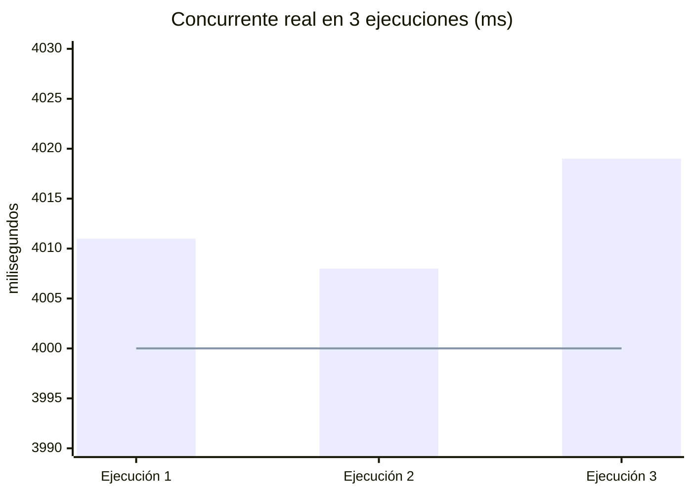

La línea marca los 4000 ms teóricos; las barras quedan siempre **unos pocos ms por encima** (nunca por debajo), porque `sleep` garantiza *como mínimo* el tiempo pedido.

**¿De dónde sale el no-determinismo?**

```mermaid
flowchart LR
    M["main llama a<br/>start() W1, W2, W3, W4<br/>(en ese orden)"] --> Q["Cola de hilos listos<br/>(RUNNABLE)"]
    Q --> P{"Planificador<br/>del sistema operativo"}
    P -->|"decide quién<br/>usa la CPU"| C1["Núcleo 1"]
    P --> C2["Núcleo 2"]
    P --> C3["Núcleo …"]
    C1 --> O["Orden de los INICIO<br/>en consola: ¡variable!"]
    C2 --> O
    C3 --> O
    style P fill:#fff4d6,stroke:#b58105
    style O fill:#fde2e2,stroke:#b42318
```

`start()` solo pone el hilo en la cola de "listos": **quién se ejecuta primero lo decide el planificador**, y eso depende de la carga del equipo, de cuántos núcleos hay libres, etc.

**Qué cambia entre ejecuciones**
- El **orden en que los workers imprimen «INICIO»** y cómo se intercalan con los mensajes de `main`: lo decide el **planificador del sistema operativo**, no el orden de los `start()`. `start()` solo dice "este hilo ya puede ejecutarse"; cuándo recibe CPU no está garantizado.
- Los **milisegundos exactos** (del secuencial, del concurrente y de cada muestra del espía): hay pequeñas latencias al crear y planificar los hilos, y `sleep` garantiza *como mínimo* ese tiempo, nunca exacto.

**Qué no cambia**
- El **orden de los «COMPLETADO»**: `creditos` (1 s) → `intro` (1,5 s) → `teaser` (2,5 s) → `episodio-1` (4 s). Las duraciones están separadas por 500 ms o más, mucho más que el ruido del planificador, así que el que menos duerme siempre acaba antes.
- El **tiempo concurrente ≈ 4000 ms** (el más lento) y el **secuencial ≈ 9000 ms** (la suma), con un ahorro estable de ~55-56 %.
- El **resumen sale siempre después del último «COMPLETADO»**, porque `main` está bloqueado en `join()` hasta que terminan los cuatro.

---

## 9. Ampliación: el Espía como hilo demonio

El espía se marca con `espia.setDaemon(true)` **antes** de su `start()` ([`MainUDITflix.java:64`](src/MainUDITflix.java#L64)).

**Regla de la JVM:** el programa termina cuando **ya no quedan hilos no-demonio vivos**. Los hilos demonio no mantienen viva la JVM: si solo quedan ellos, la JVM sale y los corta.

- **Siendo demonio:** si por cualquier motivo el espía no llegara a salir de su bucle (por ejemplo, por un fallo en la condición de parada), el programa terminaría igualmente en cuanto acabasen `main` y los workers. Es un hilo «de servicio» que nunca debe bloquear el cierre.
- **Si no fuera demonio:** el programa no terminaría hasta que el espía acabase su `run()`. En esta solución acabaría igual, porque el espía se detiene solo al ver los 4 `TERMINATED`. Pero si la condición estuviera mal hecha (por ejemplo, un `while (true)` sin `break`), la JVM se quedaría **colgada para siempre** aunque todo el trabajo real hubiera terminado: justo el tipo de bloqueo que el cliente quería eliminar.

> Nota: en el código además hago `espia.join()`, pero solo para que su última traza salga antes del resumen, no para que el programa termine.

**¿Cuándo termina la JVM?**

```mermaid
flowchart TD
    S(["Termina un hilo"]) --> Q{"¿Queda algún hilo<br/>NO-demonio vivo?"}
    Q -->|"Sí"| W["La JVM sigue funcionando"]
    Q -->|"No"| D["La JVM corta los hilos demonio<br/>que queden y termina"]
    style D fill:#e3f7e8,stroke:#1a7f37
    style W fill:#fff4d6,stroke:#b58105
```

**Escenario con un espía defectuoso (bucle infinito): demonio vs. no-demonio**

```mermaid
sequenceDiagram
    participant JVM
    participant M as main
    participant W as Workers
    participant E as ESPIA (con fallo)

    rect rgb(227, 247, 232)
    Note over JVM,E: ✅ setDaemon(true)
    M->>W: join() × 4
    W-->>M: todos TERMINATED
    M-->>JVM: main termina
    Note over E: sigue en su bucle…
    JVM->>E: solo quedan demonios → se corta
    Note over JVM: el programa TERMINA
    end

    rect rgb(253, 226, 226)
    Note over JVM,E: ❌ sin setDaemon (hilo normal)
    M->>W: join() × 4
    W-->>M: todos TERMINATED
    M-->>JVM: main termina
    Note over E: sigue en su bucle…
    Note over JVM: queda un hilo no-demonio vivo<br/>→ el programa se QUEDA COLGADO
    end
```

| | Espía demonio (`setDaemon(true)`) | Espía normal |
|---|---|---|
| ¿Mantiene viva la JVM? | No | Sí |
| Si su bucle funciona bien | El programa termina | El programa termina |
| Si su bucle tiene un fallo | El programa termina igual | **El programa no termina nunca** |
| Uso típico | Tareas de fondo: monitores, logs, recolector de basura | Trabajo que debe completarse sí o sí |

## 10. Errores típicos que evita esta solución

| Error | Qué pasaría | Cómo lo evita el código |
|---|---|---|
| Llamar a `w.run()` en vez de `w.start()` en el modo concurrente | No se crea ningún hilo; todo corre en `main`; ≈ 9000 ms. | Se usa `start()` en la [línea 58](src/MainUDITflix.java#L58). |
| Poner `start()` y `join()` en el mismo bucle | Cada hilo espera al anterior: secuencial con hilos, ≈ 9000 ms. | Dos bucles separados ([57-61](src/MainUDITflix.java#L57-L61) y [69-71](src/MainUDITflix.java#L69-L71)). |
| No hacer `join()` | El resumen sale antes de que acaben los workers; tiempo medido ≈ 0 ms. | `join()` sobre los 4 workers. |
| Parar el cronómetro antes del último `join()` | Se mide un tiempo menor que el real. | `duracion` se calcula después del bucle de `join()` ([línea 72](src/MainUDITflix.java#L72)). |
| Espía sin condición de parada | El programa no acaba nunca (si no es demonio). | `todosTerminados()` + `break`, y además es daemon. |
| `setDaemon(true)` después de `start()` | `IllegalThreadStateException`. | Se llama antes de `start()` ([línea 64](src/MainUDITflix.java#L64)). |
| Porcentaje con división entera | Se pierden los decimales. | Se usa `100.0` ([línea 88](src/MainUDITflix.java#L88)). |

## 11. Preguntas de metacognición

**¿Por qué el tiempo total concurrente no es la suma de las duraciones?**
Porque los cuatro hilos esperan **a la vez**: mientras `episodio-1` duerme 4 s, los otros tres hacen su trabajo en paralelo. El total lo marca el más lento (≈ 4000 ms), no la suma (9000 ms). En el modo secuencial cada tarea empieza cuando acaba la anterior, de ahí los ≈ 9000 ms.

**¿Qué diferencia hay entre `run()` y `start()`?**
`run()` es una llamada normal a un método: se ejecuta en el hilo que la invoca (en el modo secuencial todas las trazas salen como `[main]`). `start()` pide a la JVM un hilo nuevo, que pasa de `NEW` a `RUNNABLE` y ejecuta `run()` por su cuenta (las trazas salen como `[WORKER-n]`).

**¿Para qué sirve `join()` y dónde colocarlo?**
Bloquea a `main` hasta que termina el hilo indicado. Va en un bucle **separado** del de `start()`: primero se lanzan todos y luego se espera a todos. Sin `join()`, el resumen saldría antes de que terminasen los workers y el tiempo medido sería casi 0.

**¿Por qué el espía ve `TIMED_WAITING` y casi nunca `RUNNABLE`?**
El trabajo simulado es `Thread.sleep()`, y un hilo dormido con tiempo está en `TIMED_WAITING`. El paso por `RUNNABLE` dura microsegundos (arrancar e imprimir «INICIO»), así que solo se captura consultando `getState()` justo después de `start()`.

**¿Por qué `Runnable` y no extender `Thread`?**
Separa la tarea del mecanismo de ejecución. La misma `TareaTranscodificacion` me sirve para medir el modo secuencial (`run()`) y el concurrente (`new Thread(tarea).start()`), y la clase queda libre para heredar de otra si hiciera falta.

**¿Qué ha sido lo más difícil de depurar?**
Lo que más me costó fue conseguir que el estado `RUNNABLE` apareciera en la traza. En la primera versión, el espía solo mostraba `TIMED_WAITING` y `TERMINATED`, y al principio pensé que el espía arrancaba tarde o que estaba leyendo mal los estados. Al revisarlo entendí que no era un fallo: un worker solo está en `RUNNABLE` durante los microsegundos que tarda en arrancar e imprimir «INICIO», y enseguida entra en `Thread.sleep()`. Cuando el espía hacía su primera muestra, los cuatro ya estaban dormidos. Lo solucioné consultando `getState()` desde `main` justo después de cada `start()`, que es el único momento en el que se puede ver ese estado.

**¿Qué he aprendido?**
Lo principal es que crear hilos no basta para tener concurrencia: hay que lanzarlos y esperarlos en el orden correcto. Lo he visto con números. La misma tarea ejecutada con `run()` tarda unos 9000 ms y con `start()` unos 4000 ms. Y si pongo el `join()` dentro del mismo bucle que el `start()`, vuelvo a los 9000 ms aunque haya cuatro hilos. Ahora entiendo que `start()` vuelve al instante y que `join()` es lo que bloquea, y que el tiempo total en concurrente lo marca la tarea más lenta, no la suma de todas.

También he aprendido a "ver" un hilo por dentro con `getState()`, y que sus estados corresponden a lo que está haciendo el código en ese momento: `NEW` antes de arrancar, `TIMED_WAITING` durante el `sleep` y `TERMINATED` al acabar `run()`. Además, he comprobado que la concurrencia no es determinista. El orden de los mensajes «INICIO» y los milisegundos exactos cambian en cada ejecución porque los decide el planificador del sistema operativo. Lo que sí está garantizado es el orden lógico que impone `join()`: el resumen siempre sale al final. Por último, con el hilo demonio he entendido que un hilo secundario puede impedir que el programa termine, y que hay que decidir conscientemente si debe mantener viva la JVM o no.
