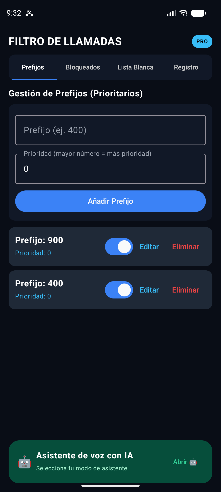
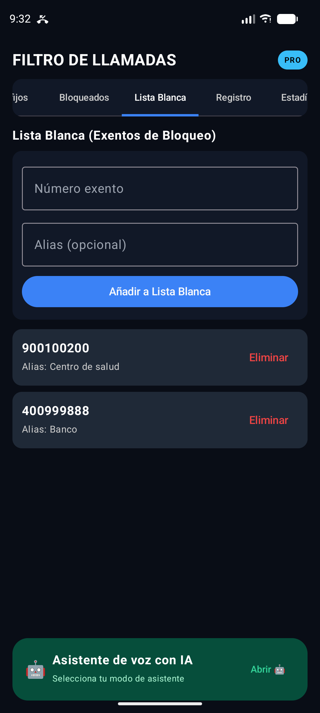
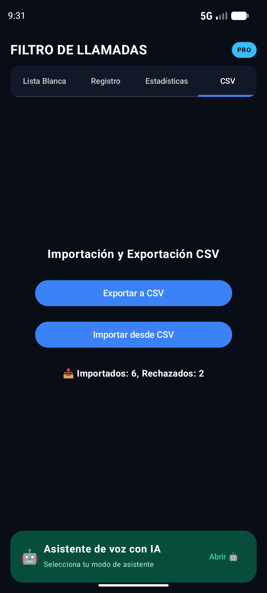
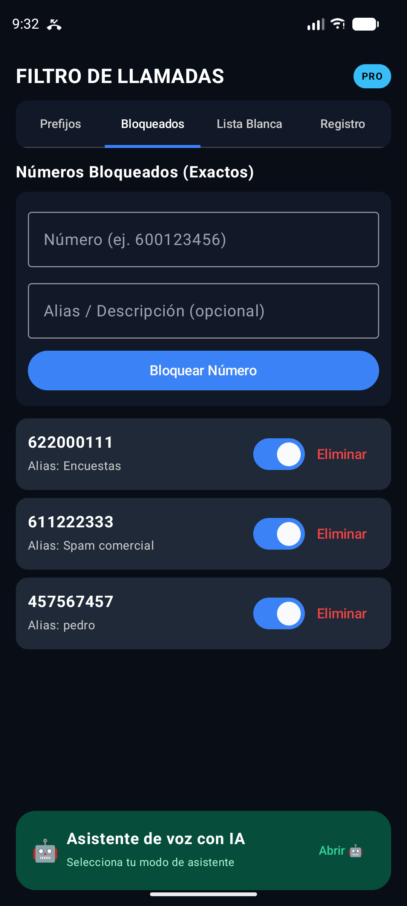
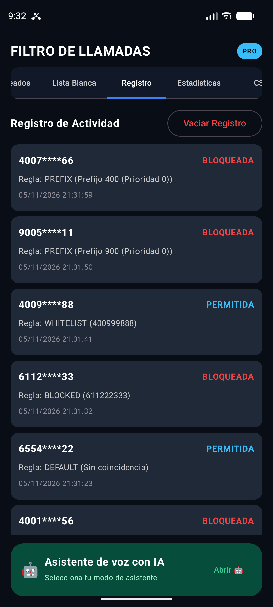
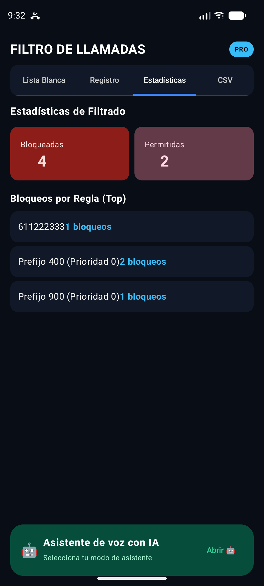
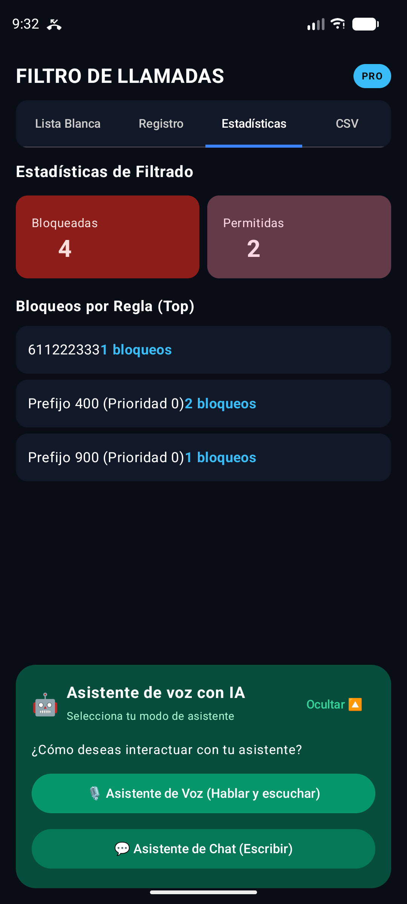

# Reto 3 · Filtro400: filtro de llamadas comerciales

Aplicación Android, escrita en Kotlin con Jetpack Compose, que **bloquea las llamadas entrantes** de números comerciales (por defecto, los que empiezan por **400**). Se integra con el sistema mediante `CallScreeningService`, de modo que Android le consulta cada llamada antes de que suene el teléfono. Todo el filtrado ocurre dentro del dispositivo.

Además del prefijo 400, el usuario puede configurar:

- **Prefijos** con prioridad (400, 900…), que se pueden activar, desactivar, editar y eliminar.
- **Números bloqueados** exactos, con alias.
- **Lista blanca**: números que nunca se bloquean.
- **Registro de actividad** con los números enmascarados, **estadísticas** e **importación/exportación CSV**.
- Un **asistente de IA** (voz o chat) que resume las llamadas recibidas.

| Dato | Valor |
|---|---|
| Lenguaje / UI | Kotlin 2.2 · Jetpack Compose · Material 3 |
| `minSdk` / `targetSdk` | 29 (Android 10) / 37 |
| Persistencia | SQLite (`SQLiteOpenHelper`), base de datos `filtros.db` en versión 3 |
| Arquitectura | MVVM: Compose → `FiltroViewModel` (StateFlow) → `FiltroRepository` → SQLite |
| Tests | 20 tests JVM (JUnit 4), todos superados |

---

## Capturas del funcionamiento

Las capturas se tomaron en un emulador **Pixel 6 (API 37)**. Las reglas se cargaron con un CSV de prueba. Después se simularon seis llamadas entrantes reales con `adb emu gsm call <número>`, así que el registro y las estadísticas que se ven abajo los generó el propio `CallScreeningService`, no datos inventados.

Este es el CSV que se importó:

```csv
tipo;valor;alias;activo
prefijo;400;Prioridad 5;1
prefijo;900;Prioridad 1;1
bloqueado;+34 611 222 333;Spam comercial;1
bloqueado;622000111;Encuestas;1
blanca;400999888;Banco;1
blanca;0034 900 100 200;Centro de salud;1
prefijo;abc;;1        <- rechazada: prefijo inválido
fax;123;;1            <- rechazada: tipo desconocido
```

| Prefijos | Lista blanca | Importación CSV |
|:-:|:-:|:-:|
|  |  |  |
| Prefijos 400 y 900 activos, cada uno con su Switch, Editar y Eliminar. | Los números se guardan **normalizados**: `0034 900 100 200` pasa a `900100200`. | 6 líneas importadas y 2 rechazadas (`abc` y el tipo `fax`). |

| Números bloqueados | Registro de actividad | Estadísticas |
|:-:|:-:|:-:|
|  |  |  |
| Coincidencia exacta. `+34 611 222 333` se guarda como `611222333`. | Cada llamada real con el número **enmascarado**, la decisión y la regla que la tomó. | Totales y bloqueos por regla, calculados con `GROUP BY` sobre la tabla `registro`. |

<p align="center"><br><em>Tarjeta del asistente de IA: el usuario elige entre modo voz y modo chat.</em></p>

Resultado de las llamadas simuladas (salida de `adb logcat -s Filtro400`):

| Número entrante | Decisión | Regla aplicada | Qué demuestra |
|---|---|---|---|
| `400123456` | BLOQUEADA | `PREFIX` 400 | Caso principal del reto |
| `655443322` | PERMITIDA | `DEFAULT` | Ninguna regla coincide, así que la llamada pasa |
| `611222333` | BLOQUEADA | `BLOCKED` | Número exacto bloqueado |
| `400999888` | PERMITIDA | `WHITELIST` | **La lista blanca gana al prefijo 400** |
| `900555111` | BLOQUEADA | `PREFIX` 900 | Prefijo configurable por el usuario |
| `400777666` | BLOQUEADA | `PREFIX` 400 | — |

---

## Estructura del código fuente

```
app/src/main/
├── AndroidManifest.xml            Registro del servicio y permisos
└── java/com/example/filtro400/
    ├── FiltroLlamadasService.kt   ★ CallScreeningService: decide cada llamada
    ├── MotorFiltrado.kt           ★ Lógica de decisión (Kotlin puro, sin Android)
    ├── ReglaBloqueo.kt            Regla original de la Fase 1 (solo el prefijo 400)
    ├── Decision.kt                Resultado: permitir, tipo de regla y referencia
    ├── FiltroRepository.kt        SQLite, migraciones y caché en memoria
    ├── FiltroViewModel.kt         Estado de la UI con StateFlow
    ├── CsvParser.kt               Importación y exportación CSV (dominio puro)
    ├── FiltroItem.kt / NumeroBloqueadoItem.kt / ListaBlancaItem.kt / RegistroItem.kt
    ├── MainActivity.kt            UI Compose: pestañas, rol y asistente
    ├── ia/
    │   ├── GroqClient.kt          Cliente HTTP para la API de Groq (LLM)
    │   ├── BaseConocimiento.kt    Prompts del asistente
    │   ├── Voz.kt                 Text-to-Speech y SpeechRecognizer nativos
    │   └── UiIaComponentes.kt     Burbujas de chat y barra de entrada
    └── ui/theme/                  Tema oscuro Material 3
```

### 1. Declaración del servicio: `AndroidManifest.xml`

```xml
<service
    android:name=".FiltroLlamadasService"
    android:exported="true"
    android:permission="android.permission.BIND_SCREENING_SERVICE">
    <intent-filter>
        <action android:name="android.telecom.CallScreeningService" />
    </intent-filter>
</service>
```

- `exported="true"` es necesario porque quien se enlaza al servicio es el proceso **Telecom** del sistema, no la propia app.
- `BIND_SCREENING_SERVICE` es un permiso de firma del sistema, así que **solo Android** puede enlazarse al servicio. Ninguna otra app puede invocarlo para consultar las reglas.
- `INTERNET` y `RECORD_AUDIO` solo los usa el asistente de IA. El filtrado no necesita ninguno de los dos.

### 2. El servicio: `FiltroLlamadasService.kt`

```kotlin
override fun onScreenCall(callDetails: Call.Details) {
    val esEntrante = callDetails.callDirection == Call.Details.DIRECTION_INCOMING
    val numero = callDetails.handle?.schemeSpecificPart.orEmpty()   // "tel:400123456" -> "400123456"

    val rules = FiltroRepository.getInstance(applicationContext).getRulesForService() // caché en memoria
    val decision = MotorFiltrado.decidirDetallado(numero, rules.first, rules.second, rules.third)
    val bloquear = esEntrante && !decision.permitir

    respondToCall(callDetails, CallResponse.Builder()
        .setDisallowCall(bloquear)      // no deja entrar la llamada
        .setRejectCall(bloquear)        // la rechaza (el llamante oye que comunica)
        .setSkipNotification(bloquear)  // sin notificación de llamada perdida
        .build())

    // Después de responder: registro enmascarado en un hilo aparte
    Thread { repository.registrarLlamada(momento, numeroEnm, estadoDecision, ...) }.start()
}
```

Puntos clave:

1. **Solo se filtran llamadas entrantes.** Las salientes nunca se bloquean.
2. **Primero se responde y después se registra.** Android concede poco tiempo para responder (unos 5 s). La decisión se toma con datos que ya están en memoria y la escritura en SQLite se hace en segundo plano.
3. Los tres flags se activan juntos. Así una llamada bloqueada no suena, el llamante oye que la línea está ocupada y el usuario no recibe ninguna notificación.

### 3. El motor de decisión: `MotorFiltrado.kt`

Es un `object` de Kotlin **sin dependencias de Android**. Por eso se puede probar con JUnit en la JVM sin emulador.

**Normalización.** Un mismo número puede llegar como `400123456`, `+34400123456`, `0034 400 123 456`…

```kotlin
fun normalizar(numero: String): String {
    val limpio = numero.filter { it.isDigit() || it == '+' }   // quita espacios y guiones
    return when {
        limpio.startsWith("+34")  -> limpio.removePrefix("+34")
        limpio.startsWith("0034") -> limpio.removePrefix("0034")
        else -> limpio
    }
}
```

Gracias a esto, un número internacional que solo *contiene* "400" (por ejemplo `+44 400…`) **no** se bloquea, porque el prefijo de país `+44` no se quita y el número no empieza por 400.

**Resolución de conflictos.** El orden es determinista y la primera regla que coincide decide:

```
1. Lista blanca exacta     -> PERMITIR  (siempre gana)
2. Número bloqueado exacto -> BLOQUEAR
3. Prefijos activos, por prioridad DESC y después por id DESC -> el primero que coincida BLOQUEA
4. Sin coincidencias       -> PERMITIR  (por defecto no se bloquea)
```

La función devuelve un `Decision(permitir, tipoRegla, reglaRef)` en lugar de un simple `Boolean`. Así el registro y las estadísticas pueden explicar **por qué** se tomó cada decisión.

**Enmascaramiento.** `enmascararNumero("400123456")` devuelve `"4001****56"`. El registro nunca guarda el número completo.

`ReglaBloqueo.kt` es la versión de la Fase 1, con el prefijo 400 fijo en el código. Se conserva junto con sus tests como referencia de la evolución del proyecto.

### 4. Persistencia: `FiltroRepository.kt`

Es un `SQLiteOpenHelper` **singleton**. Lo comparten la Activity y el servicio, que se ejecutan en el mismo proceso. Gestiona cuatro tablas:

| Tabla | Columnas principales |
|---|---|
| `filtro` | `prefijo UNIQUE`, `activo`, `prioridad`, `creado_en` |
| `numero_bloqueado` | `numero_normalizado UNIQUE`, `alias`, `activo` |
| `lista_blanca` | `numero_normalizado UNIQUE`, `alias` |
| `registro` | `momento`, `numero_enmascarado`, `decision`, `tipo_regla`, `regla_ref` |

- **Semilla:** `onCreate` inserta el prefijo `400`, así que la app bloquea desde el primer arranque.
- **Migración:** `onUpgrade` pasa de v2 a v3 con `ALTER TABLE … ADD COLUMN prioridad` y `CREATE TABLE IF NOT EXISTS`, sin perder los filtros que ya existían.
- **Caché en memoria:** dos `HashSet` (lista blanca y bloqueados) y una lista de prefijos activos ya ordenada, todos `@Volatile`. Cada escritura llama a `refreshCaches()`, de modo que un cambio en la UI se aplica **a la siguiente llamada**, sin reiniciar nada. El servicio solo lee de la caché, con búsquedas O(1) en los sets.
- **Retención:** al iniciarse, el ViewModel borra los registros con más de 30 días (`limpiarLogsAntiguos(30)`).
- Las operaciones devuelven `Result<T>`. Los errores, como un duplicado que viola `UNIQUE` o un prefijo inválido, llegan a la UI sin lanzar excepciones.

### 5. ViewModel y UI: `FiltroViewModel.kt` y `MainActivity.kt`

- El ViewModel expone `StateFlow` para filtros, bloqueados, lista blanca, registro, estadísticas y errores. Tras cada operación vuelve a cargar los datos (`cargarTodo()`).
- La UI es un `ScrollableTabRow` con seis pestañas: Prefijos, Bloqueados, Lista blanca, Registro, Estadísticas y CSV. Las listas usan `LazyColumn`, que solo compone los elementos visibles.
- **`RoleStatusBadge`** consulta `RoleManager.isRoleHeld(ROLE_CALL_SCREENING)`. Si la app no tiene el rol, muestra el botón **"Activar Rol"**, que lanza `createRequestRoleIntent(...)`. Cuando el usuario acepta, aparece la insignia **PRO**.
- **CSV:** usa el *Storage Access Framework* (`CreateDocument` y `OpenDocument`), por lo que **no hace falta ningún permiso de almacenamiento**. El usuario elige el fichero en el selector del sistema.

### 6. CSV: `CsvParser.kt`

Formato `tipo;valor;alias;activo`, con `tipo` igual a `prefijo`, `bloqueado` o `blanca`. La importación es **tolerante a fallos**: valida cada línea por separado, ignora la cabecera y las líneas vacías, y devuelve un `CsvImportResult(importados, rechazados, errores)` con el número de línea y el motivo de cada rechazo. Una línea incorrecta no estropea el resto.

### 7. Asistente de IA: paquete `ia/`

- `Voz.kt` envuelve `TextToSpeech` (es-ES) y `SpeechRecognizer`. Pide `RECORD_AUDIO` en tiempo de ejecución solo cuando el usuario pulsa el micrófono.
- `GroqClient.kt` llama a la API de Groq (modelo `llama-3.3-70b-versatile`) con `HttpURLConnection` en `Dispatchers.IO`.
- `BaseConocimiento.promptDueno()` añade al prompt **el registro con los números ya enmascarados** y le indica al modelo que no invente datos.
- Es un módulo **opcional y separado del filtrado**. Si no hay red, el bloqueo sigue funcionando igual.

---

## Decisiones técnicas

| Decisión | Motivo |
|---|---|
| **`CallScreeningService` + `ROLE_CALL_SCREENING`** | Es la API oficial para filtrar llamadas sin ser la app de teléfono. Las alternativas antiguas, como `BroadcastReceiver` con `PHONE_STATE` o `ITelephony.endCall()` por reflexión, ya no funcionan o están prohibidas en las versiones modernas de Android. |
| **`minSdk 29`** | `RoleManager` y `ROLE_CALL_SCREENING` existen desde Android 10. |
| **Motor de decisión en Kotlin puro** | Separa la lógica de negocio de Android, permite tests JVM rápidos y la comparten el servicio, la UI y el asistente. |
| **Caché en memoria en lugar de consultar SQLite en cada llamada** | `onScreenCall` debe responder rápido. Leer de un `HashSet` en memoria es inmediato y no bloquea. |
| **Singleton del repositorio** | Una sola conexión SQLite y una sola caché para la Activity y el servicio, sin estados desincronizados. |
| **SQLite directo (`SQLiteOpenHelper`) en lugar de Room** | Pocas tablas y consultas sencillas. Evita kapt/KSP y deja ver el SQL tal cual (`GROUP BY`, migraciones). |
| **Responder primero y registrar después en otro hilo** | No retrasar la respuesta a Telecom por una escritura en disco. |
| **Números enmascarados en el registro** | Privacidad: ni el registro, ni el CSV de estadísticas, ni el prompt enviado a la IA contienen números completos. |
| **Por defecto, PERMITIR** | Es preferible dejar pasar una llamada comercial a bloquear una llamada legítima (médico, colegio…). |
| **Lista blanca con prioridad absoluta** | Da al usuario una vía segura para salvar excepciones, como el banco o el centro de salud que usan números 400 o 900. |
| **SAF para el CSV** | No hacen falta permisos de almacenamiento, que además están muy restringidos desde Android 11. |
| **`Decision` con motivo** | Hace la app explicable: el usuario ve qué regla bloqueó cada llamada. |

---

## Pruebas

```bash
./gradlew testDebugUnitTest
```

| Clase | Tests | Qué cubre |
|---|---|---|
| `ReglaBloqueoTest` | 8 | Prefijo 400 con o sin `+34`/`0034` y con espacios; móviles, fijos e internacionales; número vacío |
| `MotorFiltradoTest` | 6 | Varios prefijos, filtros inactivos ignorados, lista de filtros vacía, validación de prefijos |
| `Fase3Test` | 5 | Enmascaramiento, lista blanca por encima de todo, bloqueado por encima del prefijo, prioridad entre prefijos, CSV |
| `ExampleUnitTest` | 1 | Plantilla |

**Resultado: 20/20 tests superados.** También se probó de forma manual en el emulador con llamadas reales (`adb emu gsm call`), como se ve en la tabla de capturas.

### Cómo ejecutar

1. *(Opcional, solo para el asistente de IA)* Añadir la clave de Groq en `local.properties`, en la raíz del proyecto:
   ```properties
   GROQ_API_KEY=tu_clave_de_groq
   ```
   Sin la clave, el filtrado funciona igual; solo el asistente mostrará el error "Falta la API Key de Groq".
2. Abrir el proyecto en Android Studio y ejecutarlo en un dispositivo o emulador con **Android 10 o superior**.
3. Pulsar **"Activar Rol"** y elegir *Filtro400* como app de identificación de llamadas y spam.
4. Probar desde la terminal del emulador:
   ```bash
   adb emu gsm call 400123456   # se bloquea: no suena
   adb emu gsm call 655443322   # suena con normalidad
   adb logcat -s Filtro400      # muestra la decisión tomada en cada llamada
   ```

---

## Limitaciones conocidas

- **Clave de la API de Groq.** No está en el código fuente: se define como `GROQ_API_KEY=...` en `local.properties` (ignorado por git) y Gradle la pasa a `BuildConfig.GROQ_API_KEY`. Así no llega al repositorio, pero **sí va dentro del APK compilado**, de donde se podría extraer. La solución completa es un backend propio que haga de intermediario.
- **El simulador de llamadas** tiene la lógica hecha (`FiltroViewModel.simularLlamada`), pero no tiene todavía una pestaña en la UI.
- **La prioridad de los prefijos no se conserva al pasar por el CSV.** La exportación la guarda en el alias (`Prioridad 5`), pero la importación inserta los prefijos con prioridad 0, como se ve en la captura de Prefijos.
- Las operaciones del repositorio se lanzan con `viewModelScope.launch` en el hilo principal. Con pocos datos no se nota, pero deberían ejecutarse en `Dispatchers.IO`.
- La normalización solo contempla el prefijo de país español (`+34` / `0034`).

---

## Reflexión crítica

### ¿Qué es `CallScreeningService` y qué función cumple en Android?

Es un **servicio del framework Telecom** (`android.telecom.CallScreeningService`, disponible desde la API 24 y abierto a apps de terceros mediante roles desde Android 10). Una app puede extenderlo para **examinar las llamadas antes de que se muestren al usuario**. Cuando entra una llamada, el sistema se enlaza al servicio y llama a `onScreenCall(Call.Details)`, que trae el número (`handle`), la dirección de la llamada, el estado de verificación STIR/SHAKEN, etc. La app debe contestar con `respondToCall()` y un `CallResponse`, en el que indica si quiere:

- **No permitir** la llamada (`setDisallowCall`).
- **Rechazarla** (`setRejectCall`), de forma que el llamante oye que comunica.
- **Silenciarla** (`setSilenceCall`) o **no notificarla** (`setSkipNotification`).
- **No anotarla en el registro de llamadas del sistema** (`setSkipCallLog`).

En definitiva, es el punto de enganche oficial y seguro para los filtros de spam e identificadores de llamadas. Sustituye a los trucos antiguos con `BroadcastReceiver` y reflexión sobre `ITelephony`, que Google cerró por motivos de seguridad. En este proyecto, `FiltroLlamadasService` es esa pieza: recibe la llamada, pregunta a `MotorFiltrado` y responde.

### ¿Por qué necesitamos solicitar el rol `ROLE_CALL_SCREENING`?

Porque decidir qué llamadas recibe el usuario es una **capacidad muy sensible**. Una app maliciosa podría bloquear todas las llamadas o espiar quién llama. Por eso Android no la concede con un permiso normal del manifest, sino con un **rol** que:

1. **Solo puede tener una app a la vez.** Es la "app de identificación de llamadas y spam" del sistema.
2. **Concede el usuario de forma explícita**, en el diálogo que abre `RoleManager.createRequestRoleIntent(...)`. Puede retirarlo cuando quiera desde *Ajustes → Aplicaciones predeterminadas*.
3. **Es la condición para que el sistema enlace el servicio.** Declarar el `<service>` en el manifest no basta: si la app no tiene el rol, Telecom **nunca llama** a `onScreenCall`. Por eso la UI muestra el botón "Activar Rol" mientras no se tenga y la insignia PRO cuando ya se tiene.

Sin el rol, la app se instala y su interfaz funciona, pero no filtra ninguna llamada.

### ¿Por qué no necesitamos un servidor externo para realizar el filtrado?

Porque **toda la información necesaria ya está en el dispositivo**:

- El número entrante nos lo da Android en `Call.Details`.
- Las reglas (prefijos, bloqueados y lista blanca) están en la **SQLite local** y en una caché en memoria.
- La decisión es una comparación de cadenas (`startsWith` y una búsqueda en un `HashSet`), que tarda microsegundos.

Esto tiene varias ventajas:

- **Privacidad:** los números que llaman al usuario nunca salen del móvil.
- **Latencia y fiabilidad:** el sistema exige una respuesta rápida. Depender de la red añadiría retrasos y fallaría sin cobertura de datos, justo cuando puede estar entrando una llamada.
- **Coste cero y sin mantenimiento** de infraestructura.

Un servidor solo tendría sentido para listas de spam colaborativas o actualizadas a nivel global, que es una mejora futura. Aun así, convendría descargarlas y consultarlas en local. El asistente de IA sí usa la red, pero es una función aparte: si Groq no está disponible, el bloqueo sigue funcionando.

### ¿Qué ocurre si el número telefónico está guardado en los contactos?

La app **no consulta los contactos** (no pide `READ_CONTACTS`), así que el motor decidiría solo con las reglas. Por ejemplo, un contacto con un número 400 se bloquearía si llegara a evaluarse.

Sin embargo, **el propio Android actúa antes**. Cuando la app de filtrado **no es además la app de teléfono predeterminada**, el sistema **no envía a `CallScreeningService` las llamadas de números que están en los contactos del usuario**. Se considera que un contacto guardado es de confianza, así que la llamada suena con normalidad aunque coincida con una regla de bloqueo. Es una protección de la plataforma para que una app de filtrado no impida recibir llamadas de personas conocidas.

En la práctica, guardar un número en los contactos funciona como una "lista blanca del sistema". Para tener un comportamiento coherente y explícito dentro de la app, lo recomendable es añadir esos números también a la **Lista blanca** de Filtro400, que tiene prioridad sobre cualquier regla. Además, como el número nunca llega al servicio, esas llamadas tampoco aparecen en el registro ni en las estadísticas de la app.

### ¿Qué diferencias existen entre comprobar un número mediante una función y bloquear realmente una llamada?

| Comprobar con una función (`MotorFiltrado.decidirDetallado`, `ReglaBloqueo.debeBloquearse`) | Bloquear realmente la llamada (`FiltroLlamadasService`) |
|---|---|
| Es **lógica pura**: recibe un `String` y devuelve un `Boolean` o una `Decision`. | Es una **interacción con el sistema operativo** a través de Telecom. |
| No tiene efecto sobre el teléfono: solo **responde a una pregunta**. | Tiene un **efecto real**: el teléfono no suena, el llamante oye que comunica y no hay notificación. |
| Se ejecuta donde se quiera: tests JUnit en la JVM, la UI, el asistente. | Solo se ejecuta cuando **Android lo invoca**, con el rol concedido y con un número que no esté en contactos. |
| No necesita permisos ni dispositivo. | Necesita el manifest con `BIND_SCREENING_SERVICE`, el rol aceptado por el usuario y Android 10 o superior. |
| Se prueba con **tests unitarios** (20 tests en este proyecto). | Se prueba con **llamadas reales o simuladas** (`adb emu gsm call`) y `logcat`. |
| Es determinista e instantánea. | Tiene restricciones de tiempo (unos 5 s), depende del ciclo de vida del servicio y del estado del sistema. |

Que la función devuelva `true` **no garantiza** que la llamada se bloquee. Para que se bloquee de verdad, el servicio tiene que estar registrado, la app tiene que tener el rol, Android tiene que enlazar el servicio y este tiene que llamar a `respondToCall` con `setDisallowCall(true)`. Separar las dos cosas es justo lo que permite **probar la lógica sin un teléfono** y mantener el servicio como una capa fina de integración.

### ¿Qué mejoras incorporarías en una futura versión?

1. **Seguridad de la API de IA:** la clave ya no está en el código fuente (va en `local.properties` y `BuildConfig`). El siguiente paso es un proxy propio, para que la clave tampoco viaje dentro del APK.
2. **Pantalla del simulador:** la lógica ya existe (`simularLlamada`); falta la pestaña que muestre la decisión paso a paso.
3. **Conservar la prioridad al importar el CSV:** añadir una columna `prioridad` al formato o leerla del alias.
4. **Corrutinas en `Dispatchers.IO`** para todas las operaciones de base de datos, y migrar a **Room + Flow** para tener una UI reactiva sin recargas manuales.
5. **Números ocultos:** una regla opcional para bloquear las llamadas sin número.
6. **Franjas horarias:** por ejemplo, bloquear el prefijo 900 solo fuera del horario laboral.
7. **Usar la verificación STIR/SHAKEN** (`Call.Details.getCallerNumberVerificationStatus()`) para bloquear los números falsificados.
8. **Normalización internacional** con `libphonenumber`, en lugar de contemplar solo el prefijo +34.
9. **Listas de spam colaborativas**, descargadas de forma periódica (con WorkManager) y consultadas en local.
10. **Silenciar en lugar de rechazar** como opción para el usuario (`setSilenceCall`), y un widget o notificación con el resumen diario de llamadas bloqueadas.
11. **Tests instrumentados** del servicio y de la migración de la base de datos de v2 a v3.
